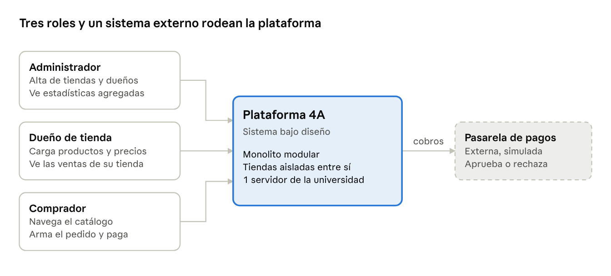
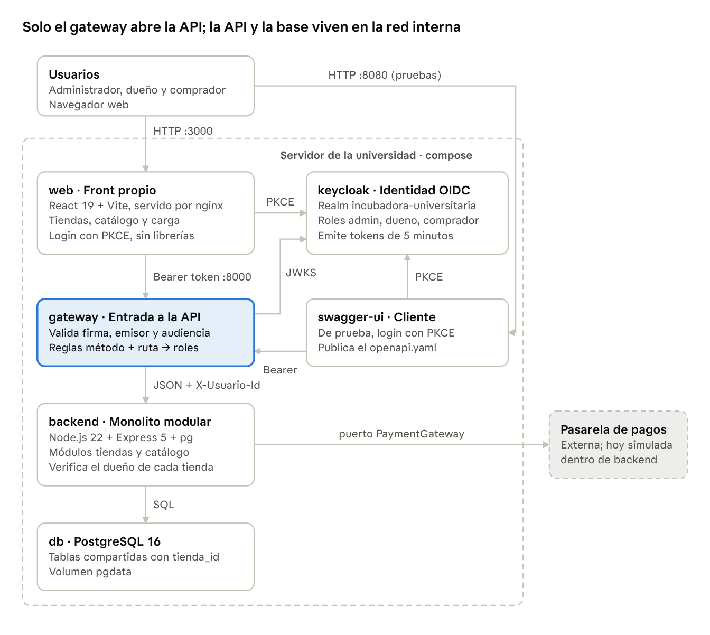

# Diagramas C4

Exportados del documento de arquitectura el 18/11/2026. Antes de cada tag se revisa que el diagrama de contenedores coincida con `infra/compose/docker-compose.yml` (ADR-6).

## Nivel 1 · Contexto

Tres roles (administrador, dueño de tienda y comprador) y un único sistema externo: la pasarela de pagos, simulada.

## Nivel 2 · Contenedores

Seis contenedores en un servidor: `web`, `gateway`, `keycloak`, `swagger-ui`, `backend` y `db`. Solo el gateway abre la API; `backend` y `db` no publican puertos.

