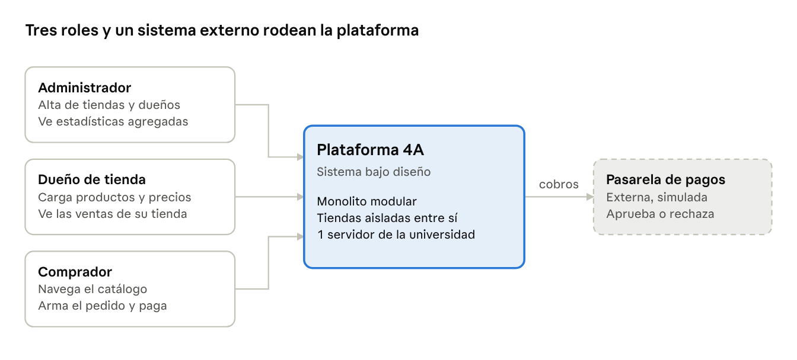
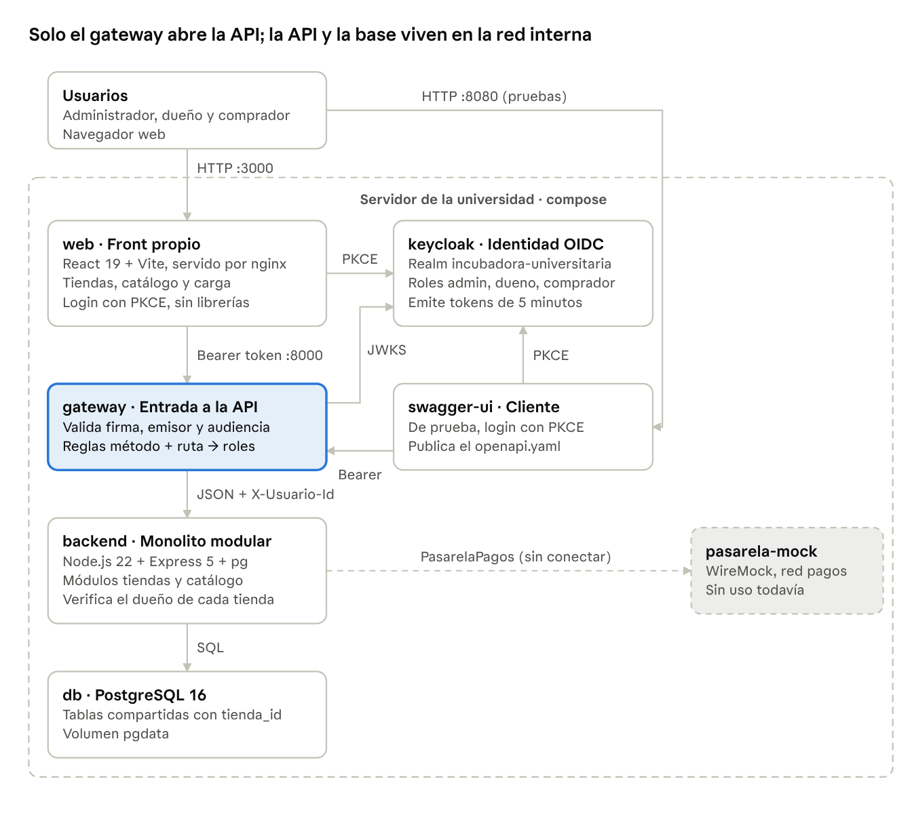

# Documento de Arquitectura – 4A Incubadora universitaria

Ariel Núñez, Ignacio Rzeszut, Luca Tabaka.

## 1. Dominio y escenario

El sistema es una plataforma multi-tienda para una incubadora universitaria: cada emprendedor gestiona su propia tienda online (catálogo, precios y ventas) y ninguno puede ver ni modificar datos de otra tienda. La plataforma además ofrece estadísticas agregadas de todas las tiendas al administrador.

Dominio 4 · Tiendas online para emprendedores. Escenario 4A · Incubadora universitaria.

La regla más importante del dominio es el **aislamiento entre tiendas** (multi-tenancy): es una invariante de negocio que condiciona el modelo de datos, la autorización y las consultas, aunque la escala sea chica.

Orden de magnitud para dimensionar: 30 tiendas × 50 productos = 1.500 productos como máximo. Es un volumen que cabe en una sola base de datos relacional sin particionado, caché distribuida ni colas externas.

| Dimensión | Definición del escenario |
| --- | --- |
| Escala | 30 tiendas, catálogos chicos (menos de 50 productos), tráfico bajo y parejo |
| Quién lo mantiene | 2 becarios que cambian todos los años |
| Infraestructura y presupuesto | Un servidor de la universidad |
| NFR estrella | Mantenibilidad y costo |
| Restricción que lo cambia todo | Un becario nuevo tiene que poder entender todo el sistema en una semana |

## 2. Actores, alcance y caso de uso mínimo

Hay tres roles y un único sistema externo: la pasarela de pagos, que se simula. Se implementa login más el caso de uso mínimo; el resto se diseña pero no se programa.

| Rol | Qué hace | Límite clave |
| --- | --- | --- |
| Administrador de la plataforma | Da de alta y baja tiendas y dueños; consulta estadísticas agregadas de todas las tiendas | No edita catálogos ni precios de una tienda |
| Dueño de tienda | Carga y edita productos y precios; ve las ventas de su tienda | Solo accede a los datos de su propia tienda |
| Comprador | Navega el catálogo de una tienda, arma el pedido y paga | Solo ve productos de la tienda que está visitando |

**Sistema externo: pasarela de pagos.** Se modela como un servicio externo con el que la plataforma se comunica por una interfaz propia (un puerto), con una implementación simulada (mock) que aprueba o rechaza pagos. Así el diseño ya contempla la integración real sin depender de un proveedor durante el desarrollo.

**Caso de uso mínimo:** un dueño de tienda carga un producto y un comprador lo ve en esa tienda, y no en otra. Es la prueba más corta de la regla de aislamiento.

**Corte a implementar:**

- [ ] Login con los tres roles — implementado: Keycloak autentica a `admin` (rol `admin`), a las dueñas `ana` y `carla` (rol `dueno`) y al comprador `beto` (rol `comprador`), desde el front `web` o desde Swagger UI. El administrador inicia sesión, pero sus funcionalidades (alta de tiendas) están diseñadas y sin implementar
- [ ] Carga de producto por el dueño — implementado: vista «Editar mi tienda» en el front (`GET /v1/mi-tienda`) y `POST /v1/tiendas/{id}/productos`; el gateway exige el rol `dueno` y la API verifica que el usuario sea el dueño de esa tienda
- [ ] Visualización del catálogo por el comprador — implementado: lista de tiendas y catálogo en el front, sobre `GET /v1/tiendas` y `GET /v1/tiendas/{id}/productos`, rutas públicas
- [ ] Verificación de que una tienda no ve los productos de otra — implementado y cubierto por tests de acceso cruzado (sección 13). El front solo ofrece cargar productos en la tienda propia; el 403 ante una tienda ajena se muestra desde Swagger UI, con `carla` intentando crear en la tienda de `ana`

Queda diseñado pero no implementado el checkout (módulo `pedidos`). Las estadísticas del administrador quedan solo como parte del escenario: no están diseñadas. La pasarela de pagos simulada ya existe (puerto, adaptador HTTP y un contenedor WireMock), pero ningún caso de uso la llama todavía: la conecta el checkout. El carrito del front es una maqueta que avisa que el checkout no está implementado.

## 3. Requerimientos no funcionales

Mantenibilidad y costo mandan sobre todo lo demás: cuando un atributo compite con ellos, gana la simplicidad. Cada NFR priorizado está escrito como escenario de calidad con el formato de la cátedra: cuando \[fuente\] hace \[estímulo\] sobre \[artefacto\] en \[entorno\], el sistema \[respuesta\], medido como \[medida\]. La columna de verificación dice dónde está la evidencia (sección 13).

| ID | Atributo | Prioridad | Escenario | Verificación |
| --- | --- | --- | --- | --- |
| NFR-1 | Mantenibilidad (comprensibilidad) | Estrella | Cuando un becario nuevo, sin conocimiento previo del sistema, hace el alta de un campo nuevo en Producto sobre el módulo catálogo, el front y la documentación (README, C4 y ADRs) en desarrollo, durante su primera semana con el equipo renovado, el sistema queda levantado en local con el campo funcionando y los tests en verde, medido como menos de 5 días hábiles desde que clona el repositorio. | Test de arquitectura |
| NFR-2 | Costo | Estrella | Cuando los becarios hacen el despliegue y la operación de un mes sobre todo el sistema en producción, en el servidor de la universidad, el sistema funciona solo con software libre y sin servicios pagos de nube, medido como costo mensual adicional igual a cero y ninguna licencia paga. | Inventario de dependencias y licencias en el README |
| NFR-3 | Seguridad y aislamiento entre tiendas | Alta | Cuando la dueña autenticada de una tienda hace el alta de un producto en una tienda ajena sobre el gateway y el módulo catálogo en operación normal, el sistema rechaza el pedido con 403 en formato Problem Details sin guardar nada, y el catálogo de cada tienda sigue mostrando solo sus productos, medido como 0 escrituras cruzadas en la suite de acceso cruzado, en memoria y contra PostgreSQL. | Tests de acceso cruzado del backend |
| NFR-4 | Seguridad general | Alta | Cuando un cliente o un atacante hace una petición a una ruta protegida sin token, con un token adulterado, vencido o emitido para otra audiencia, o con un rol insuficiente, sobre el gateway en operación normal, el sistema la rechaza en el gateway antes de que llegue a la API, con 401 y `WWW-Authenticate` o con 403, medido como el 100% de los casos de la suite del gateway rechazados. | Tests de autorización del gateway |
| NFR-5 | Operabilidad | Media | Cuando un becario hace la restauración de la base desde un backup, siguiendo solo el README, sobre la base de datos y el compose en un servidor que perdió sus datos, el sistema vuelve a funcionar con los datos del backup y logs legibles con `docker compose logs`, medido como menos de 3 horas y sin ayuda externa. | Simulacro de restauración; hoy, argumento |
| NFR-6 | Rendimiento | Media | Cuando los compradores hacen consultas al catálogo de una tienda sobre el gateway, la API y la base en tráfico bajo y parejo, con 30 tiendas de 50 productos cada una, el sistema devuelve el catálogo de esa tienda, medido como menos de 1 segundo en el percentil 95. | Prueba de carga; hoy, argumento de volumen |
| NFR-7 | Disponibilidad | Baja | Cuando una falla hace la caída del servidor o de un servicio sobre el sistema completo en operación normal, sin alta disponibilidad ni failover, el sistema se restablece a mano con Docker Compose y, si hace falta, desde el último backup, medido como menos de 4 horas sin servicio y una pérdida máxima de 24 horas de datos (backup diario). | Política de backup documentada; hoy, argumento |
| NFR-8 | Escalabilidad | Baja | Restricción declarada, no escenario: el sistema no se diseña para crecer más allá de la escala del escenario (30 tiendas de unos 50 productos cada una). Si la demanda la supera, se rediseña. | Cumplido por decisión (ADR-1 y ADR-3) |

**Compromisos asumidos:** se renuncia a escalabilidad horizontal y alta disponibilidad a cambio de simplicidad y costo cero adicional. Treinta tiendas con tráfico bajo no justifican microservicios, colas ni cachés distribuidas, y cada pieza extra encarece entender el sistema en una semana.

### Escenarios de calidad

Los siete NFR con escenario, desarmados en las seis partes de la Clase 13 (Bass, Clements y Kazman). Cada fila se lee como una oración: cuando \[fuente\] hace \[estímulo\] sobre \[artefacto\] en \[entorno\], el sistema \[respuesta\], medido como \[medida\]. NFR-8 queda afuera porque es una restricción declarada.

| NFR | Fuente | Estímulo | Artefacto | Entorno | Respuesta | Medida |
| --- | --- | --- | --- | --- | --- | --- |
| NFR-1 Mantenibilidad | Un becario nuevo, sin conocimiento previo del sistema | Hace el alta de un campo nuevo en Producto | Módulo catálogo, front y documentación (README, C4, ADRs) | Desarrollo, primera semana con el equipo renovado | Queda levantado en local con el campo funcionando y los tests en verde | Menos de 5 días hábiles desde que clona el repositorio |
| NFR-2 Costo | Los becarios | Hacen el despliegue y la operación de un mes | Todo el sistema | Producción, en el servidor de la universidad | Funciona solo con software libre, sin servicios pagos de nube | Costo mensual adicional igual a cero; ninguna licencia paga |
| NFR-3 Aislamiento | La dueña autenticada de una tienda | Hace el alta de un producto en una tienda ajena | Gateway y módulo catálogo | Operación normal | Rechaza con 403 Problem Details sin guardar nada; cada catálogo muestra solo sus productos | 0 escrituras cruzadas en la suite, en memoria y contra PostgreSQL |
| NFR-4 Seguridad | Un cliente o un atacante | Hace una petición a una ruta protegida sin token, con token adulterado, vencido o de otra audiencia, o con rol insuficiente | Gateway | Operación normal | La rechaza antes de que llegue a la API: 401 con `WWW-Authenticate` o 403 | 100% de los casos de la suite del gateway rechazados |
| NFR-5 Operabilidad | Un becario | Hace la restauración de la base desde un backup, siguiendo solo el README | Base de datos y compose | Servidor que perdió sus datos | Vuelve a funcionar con los datos del backup y logs legibles | Menos de 3 horas, sin ayuda externa |
| NFR-6 Rendimiento | Los compradores | Hacen consultas al catálogo de una tienda | Gateway, API y base | Tráfico bajo y parejo, 30 tiendas de 50 productos | Devuelve el catálogo de esa tienda | Menos de 1 s en el percentil 95 |
| NFR-7 Disponibilidad | Una falla | Hace caer el servidor o un servicio | Sistema completo | Operación normal, sin alta disponibilidad ni failover | Se restablece a mano con Docker Compose y, si hace falta, desde el último backup | Menos de 4 horas sin servicio; pérdida máxima de 24 horas de datos |

### Utility tree


El onboarding es el único escenario (A, A): es la restricción que define el escenario 4A, y Keycloak lo vuelve más difícil. Aislamiento y autenticación son (A, M). Estos tres son los que recorre la evaluación de la sección 12; la dificultad es la estimación del equipo.

## 4. Restricciones

La restricción dominante es humana, no técnica: el equipo rota cada año, así que la arquitectura se juzga por lo rápido que alguien nuevo la entiende.

| Tipo | Detalle | Impacto en el diseño |
| --- | --- | --- |
| Restricción | Un solo servidor de la universidad | Una unidad de despliegue; base de datos y aplicación en la misma máquina |
| Restricción | 2 becarios que cambian cada año | Tecnologías comunes y documentadas; evitar patrones sofisticados |
| Restricción | Sin frameworks tipo Laravel | Estructura propia, simple y explícita, con librerías chicas y acotadas |

## 5. Estilo arquitectónico: matriz de Pugh

Gana el **monolito modular** (+1): iguala al monolito en capas en costo y operación, y lo supera en mantenibilidad porque separa el código por módulo de negocio. Microservicios y event-driven solo ganan en escalabilidad, un atributo de prioridad baja en este escenario (NFR-8).

Datum: monolito en capas. Escala: +1 mejor que el datum · 0 igual · −1 peor.

| Criterio (NFR) | Monolito en capas (datum) | Monolito modular | Microservicios | Event-driven |
| --- | --- | --- | --- | --- |
| Costo de infraestructura (NFR-2) | 0 | 0 | −1 | −1 |
| Complejidad operativa (NFR-5) | 0 | 0 | −1 | −1 |
| Escalabilidad (NFR-8) | 0 | 0 | +1 | +1 |
| Curva de aprendizaje (NFR-1) | 0 | 0 | −1 | −1 |
| Mantenibilidad (NFR-1) | 0 | +1 | −1 | −1 |
| **Total** | **0** | **+1** | **−3** | **−3** |

## 6. C4 nivel 1: Contexto

La plataforma se relaciona con tres tipos de usuario y con un único sistema externo: la pasarela de pagos, simulada en esta etapa.



Los tres roles usan la misma plataforma por HTTPS; la línea punteada de la pasarela indica que es externa y, por ahora, simulada. Este nivel muestra solo quién usa el sistema y con qué se integra; la estructura interna se detalla en el C4 de contenedores.

## 7. C4 nivel 2: Contenedores

Son siete contenedores en un solo servidor, definidos en `infra/compose/docker-compose.yml`: `web`, el front propio en React servido por nginx; `gateway`, única entrada a la API, que valida el token, aplica las reglas por rol y le pasa a la API el usuario en `X-Usuario-Id`; `keycloak`, el proveedor de identidad OIDC; `backend`, el monolito modular en Node.js; `db`, PostgreSQL 16; `swagger-ui`, cliente de prueba que publica el contrato OpenAPI; y `pasarela-mock`, un WireMock que simula la pasarela de pagos externa (ADR-6).



El recuadro punteado es el servidor de la universidad. `backend` y `db` no publican puertos: solo se alcanzan por la red interna `backend`. `gateway` está en `backend` y en `identidad`, la red donde vive `keycloak`. `pasarela-mock` tampoco publica puertos: solo la ve `backend`, por la red `pagos`. La línea punteada entre ellos indica que el adaptador existe pero ningún caso de uso lo llama todavía. `web` no reenvía llamadas: entrega los archivos estáticos y después el navegador habla directo con `keycloak` (login) y con `gateway` (API), que acepta por CORS solo los orígenes de `web` y `swagger-ui` (ADR-9).

Pregunta abierta resuelta: el borrador en draw.io separaba una app para cliente y vendedor y otra para el administrador. Quedó un solo front con vistas por rol, porque es una pieza menos que entender y desplegar (NFR-1); las vistas del administrador todavía no están implementadas.

## 8. Modelo de dominio

La **Tienda** es la raíz del aislamiento: todo lo que pertenece a una tienda lleva su id (`tienda_id` en la base). La tienda viaja en la URL (`/tiendas/{id}/…`) y la API verifica que el usuario del token, que el gateway le pasa en `X-Usuario-Id`, sea el dueño de esa tienda; el cliente no puede elegir con qué usuario actúa. Los módulos del monolito siguen los contextos del dominio, y la base implementada usa nombres en español.

| Entidad | Módulo | Atributos clave | Regla de negocio | Estado |
| --- | --- | --- | --- | --- |
| Store (Tienda) | Tiendas | id, nombre, dueno\_id | Solo el administrador la da de alta o de baja; `dueno_id` es el `sub` de Keycloak del dueño | Implementada (lectura) |
| User (Usuario) | Keycloak (sin módulo propio) | Vive en Keycloak: usuario, contraseña y rol | role ∈ {admin, dueno, comprador}; la API no tiene tabla de usuarios: el vínculo dueño → tienda es `tiendas.dueno_id` | En Keycloak |
| Product (Producto) | Catálogo | id, tienda\_id, nombre, precio, stock | Pertenece a una sola tienda; precio mayor a 0 y stock entero mayor o igual a 0. Sin tope por tienda: se asumen menos de 50 (dimensionamiento, NFR-6) | Implementada |
| Order (Pedido) | Pedidos | id, store\_id, buyer\_id, status, total | Todos sus ítems son de la misma tienda que el pedido | Diseñada |
| OrderItem (Ítem) | Pedidos | order\_id, product\_id, quantity, unit\_price | El precio se congela al confirmar el pedido | Diseñada |
| Payment (Pago) | Pagos | id, order\_id, status, gateway\_ref | Lo resuelve la pasarela a través del puerto `PasarelaPagos`; el adaptador HTTP y el mock están implementados | Diseñada; pasarela lista, sin caso de uso |

**Invariantes que garantizan el aislamiento:**

1. `store_id NOT NULL` en productos y pedidos (en la base implementada, tienda\_id); el dueño de cada tienda queda en tiendas.dueno\_id.
2. Claves foráneas compuestas `(store_id, id)`: un ítem de un pedido de la tienda A no puede referenciar un producto de la tienda B, lo impide la base.
3. Los repositorios reciben `store_id` como parámetro obligatorio; no existe un método "listar todos".

Pregunta abierta: ¿el comprador tiene una cuenta única para toda la plataforma o una por tienda? Una cuenta única es más simple para el usuario; el aislamiento no cambia porque los pedidos ya llevan `store_id`.

Con Keycloak la respuesta queda tomada en la práctica: hay un solo realm, `incubadora-universitaria`, y por lo tanto una cuenta por persona para toda la plataforma.

## 9. API (resumen del OpenAPI)

La API es REST y se consume solo a través del gateway, en `http://localhost:8000/v1`, con rutas en español. El prefijo `/v1` versiona el contrato público: el gateway lo quita antes de reenviar al backend y responde 404 a cualquier ruta sin prefijo. El contrato vive en `docs/architecture/openapi/openapi.yaml` y Swagger UI lo publica en el puerto 8080. La tienda viaja en la URL y la API verifica el dueño con el usuario del token (sección 8). En la tabla, las rutas van sin el prefijo `/v1`.

| Método y ruta | Rol (regla del gateway) | Qué hace | Estado |
| --- | --- | --- | --- |
| Login y logout | Público | Los resuelve Keycloak con Authorization Code + PKCE (puerto 8180); la API no tiene endpoint propio | Implementado |
| GET /yo | Autenticado | Devuelve usuario, roles, emisor y vencimiento del token | Implementado (en el gateway) |
| GET /health | Público | Comprueba que la API y la base responden | Implementado |
| GET /tiendas | Público | Lista las tiendas | Implementado |
| GET /tiendas/{id} | Público | Devuelve una tienda | Implementado |
| GET /tiendas/{id}/productos | Público | Catálogo de una tienda | Implementado |
| POST /tiendas/{id}/productos | dueno | Crea un producto; la API verifica que el usuario sea el dueño de esa tienda | Implementado |
| GET /mi-tienda | dueno | Devuelve la tienda del usuario del token; la usa la vista «Editar mi tienda» | Implementado |
| POST /tiendas | admin | Da de alta una tienda | Regla en el gateway; falta contrato y API |
| DELETE /tiendas/{id} | admin | Da de baja una tienda | Regla en el gateway; falta contrato y API |

**Convenciones:**

- Errores en formato `application/problem+json` (RFC 9457), con el mismo cuerpo en la API y en el gateway.
- Un dueño que intenta escribir en una tienda ajena recibe 403 (NFR-3). El diseño original proponía 404 para no revelar que la tienda existe, pero las tiendas son públicas: la lista y los catálogos se leen sin login, así que un 404 no ocultaría nada y confundiría al dueño.
- 401 sin token válido, con el header `WWW-Authenticate: Bearer`; 403 cuando el rol no alcanza; 400 para errores de validación y para JSON mal formado (el diseño original proponía 422).
- Cada petición protegida lleva `Authorization: Bearer <access token>`. El gateway verifica la firma con las claves públicas de Keycloak (JWKS), el emisor, la audiencia `api-incubadora` y el vencimiento. Sin cookies no aplica CSRF. El gateway acepta por CORS una lista de orígenes (`CORS_ORIGIN`): hoy `web` (`:3000`) y Swagger UI (`:8080`). La API todavía responde CORS con `*`, aunque solo la llama el gateway.
- El front guarda el access token en `sessionStorage`: se borra al cerrar la pestaña, pero un XSS podría leerlo. Se acepta porque el token vence a los 5 minutos y React escapa el contenido que muestra (ADR-5).

## 10. Despliegue

Todo se levanta con un solo comando: `docker compose -f infra/compose/docker-compose.yml up -d --build`. Ese archivo define `db`, `backend`, `keycloak`, `gateway`, `web`, `swagger-ui` y `pasarela-mock`, más un servicio `backend-tests` que solo existe con el perfil `test` y corre los tests contra la base real. Todo vive en un único repositorio.

| Servicio | Qué corre | Expone | Datos persistentes |
| --- | --- | --- | --- |
| web | nginx (alpine) con el build estático del front en React 19 + Vite; la imagen se compila en una etapa con node:22-alpine | 3000 hacia los usuarios | No |
| gateway | Node.js 22 + Express 5 + jose: valida el token, aplica las reglas por rol y reenvía a la API con el usuario en `X-Usuario-Id` | 8000 hacia los usuarios | No |
| keycloak | Keycloak 26.2.5 en modo desarrollo; importa el realm `incubadora-universitaria` desde `infra/keycloak` | 8180 (login en el navegador) | Base interna de Keycloak, sin volumen |
| backend | Monolito modular en Node.js 22 + Express 5 + pg | Solo red backend | No |
| db | PostgreSQL 16 (alpine); la primera vez corre las migraciones de cada módulo y los datos de ejemplo de `infra/database/init` | Solo red backend | Volumen pgdata |
| swagger-ui | Swagger UI 5.17.14 con login OAuth (PKCE) contra Keycloak; cliente de prueba que publica el `openapi.yaml` | 8080 | No |
| pasarela-mock | WireMock 3.13.2 con dos escenarios de cobro (aprobado, y rechazado si el monto supera 100.000), versionados en infra/pasarela-mock/mappings | Solo red pagos | No |
| backend-tests | Solo con el perfil `test`: la imagen del backend más `tests/`, contra `db` | Solo red backend | No |

La pasarela de pagos simulada corre en su propio contenedor, `pasarela-mock` (WireMock), y no dentro de `backend`. El backend tiene el puerto `PasarelaPagos` y un adaptador HTTP con timeout de 5 segundos: si la pasarela no responde, la API devuelve 502 con Problem Details. Ningún caso de uso lo llama todavía: lo va a conectar el checkout de `pedidos`. Pasar a un proveedor real es cambiar la URL del adaptador (ADR-6).

**Operación (NFR-5 y NFR-7):**

- Backup diario con `pg_dump` programado en el servidor; se guardan los últimos 7. Pendiente de implementar.
- Restauración documentada paso a paso en el README y probada con un simulacro. Pendiente.
- Configuración por variables de entorno. Las contraseñas de desarrollo (`db` y consola de Keycloak) están escritas en `docker-compose.yml` a propósito, para que el sistema levante con un solo comando; en el servidor real van en un `.env` fuera del repositorio.
- Las imágenes del backend y del gateway corren con el usuario `node`, no como root; backend, gateway y front usan `.dockerignore`.
- Logs a la salida estándar, consultables con `docker compose logs`.

## 11. Decisiones de arquitectura (ADRs)

Cada ADR vive en `docs/architecture/adr/` y esta sección se genera a partir de esos archivos con `node docs/architecture/generar-adrs.mjs`. Para cambiar un ADR se edita su archivo, no este documento. Si se edita aquí, hay que llevar el cambio al archivo del ADR.

<!-- ADRS:INICIO (generado por generar-adrs.mjs, no editar a mano) -->

| ADR | Decisión | Estado |
| --- | --- | --- |
| ADR-1 | Monolito modular | Aceptada |
| ADR-2 | Monorepo con front y back | Aceptada |
| ADR-3 | Despliegue con Docker Compose en un solo servidor | Aceptada |
| ADR-4 | Una base relacional con aislamiento por tienda | Aceptada |
| ADR-5 | Identidad con Keycloak y gateway como única entrada a la API | Aceptada |
| ADR-6 | Pasarela de pagos detrás de un puerto, con implementación simulada | Aceptada |
| ADR-7 | Documentación viva en el repositorio | Aceptada |
| ADR-8 | Stack tecnológico | Aceptada |
| ADR-9 | Front propio como SPA estática; el gateway es la única entrada a la API | Aceptada |

### ADR-1: Monolito modular

- **Estado:** Aceptada
- **Fecha:** 2026-11-03 (revisada el 2026-11-19: se elimina el módulo `identidad`)

#### Contexto

30 tiendas con tráfico bajo, un solo servidor y 2 becarios que rotan cada año. El sistema tiene que entenderse en una semana (NFR-1, estrella) y operar a costo cero (NFR-2, estrella).

#### Decisión

Vamos a construir una sola aplicación desplegable (`apps/backend`), dividida en módulos internos por contexto de negocio: `tiendas`, `catalogo`, `pedidos` y `pagos`.

El módulo `identidad` se eliminó: el login y los roles los resuelve Keycloak (ADR-5), y la API recibe el usuario ya validado por el gateway en el header `X-Usuario-Id`.

Cada módulo tiene las mismas capas (`domain`, `application`, `infrastructure`, `presentation`, `public-api`) y solo se comunica con otro a través de su `public-api`. `src/main/` es el único lugar que conoce todas las piezas.

#### Alternativas

- **Monolito en capas** (datum de la matriz de Pugh): más simple, pero mezcla negocios distintos en las mismas capas.
- **Microservicios** y **event-driven**: −3 en la matriz de Pugh. Más infraestructura, más operación y más curva de aprendizaje; solo ganan en escalabilidad, que es prioridad baja (NFR-8).

#### Consecuencias

- Una unidad que entender, desplegar y pagar; cada módulo se lee de forma aislada.
- **Negativas:** se resigna escalar módulos por separado. Los límites entre módulos no los impone el runtime: hay que cuidar que un módulo no lea las tablas ni importe las capas internas de otro.

#### NFRs

Favorece NFR-1, NFR-2 y NFR-5. Perjudica NFR-8, que tiene prioridad baja.

#### Confirmación

El test de arquitectura `apps/backend/tests/architecture/dependencias.test.js` falla si un módulo importa capas internas de otro sin pasar por su `public-api`, o si se rompen las dependencias entre capas. Corre con `npm test` en `apps/backend`.

### ADR-2: Monorepo con front y back

- **Estado:** Aceptada
- **Fecha:** 2026-11-03 (revisada el 2026-11-19: se quita el módulo `identidad` de la lista, ver ADR-1)

#### Contexto

Primero se separaron front y back en dos repositorios. El equipo cambia cada año y la entrega se hace con un único tag.

#### Decisión

Vamos a usar un único repositorio con el front, el back, la infraestructura y la documentación juntos. Los nombres de carpetas van en inglés (`apps/`, `infra/`, `docs/`) y los módulos de negocio en español (`tiendas`, `catalogo`, `pedidos`, `pagos`).

#### Alternativas

- **Dos repositorios,** uno para el front y otro para el back: es la opción que se probó primero y se descartó.

#### Consecuencias

- Un solo clon, un solo `docker compose up`, un solo tag `v1.0`; los cambios que tocan front y back van en el mismo commit.
- **Negativas:** se resigna versionar y desplegar front y back por separado (no hace falta a esta escala). Cada parte tiene su propio `package.json` y `node_modules`, así que hay que instalar dependencias en tres carpetas.

#### NFRs

Favorece NFR-1 y NFR-5.

#### Confirmación

Un solo clon del repositorio alcanza para levantar todo y correr todos los tests; el tag `v1.0` cubre código, infraestructura y documentación.

### ADR-3: Despliegue con Docker Compose en un solo servidor

- **Estado:** Aceptada
- **Fecha:** 2026-11-03 (revisada el 2026-11-18: se suma `web`) (revisada el 2026-11-19: se suma `pasarela-mock`)

#### Contexto

Un solo servidor de la universidad, sin servicios de nube y con becarios que tienen que desplegar sin ayuda.

#### Decisión

Vamos a definir los servicios en Compose y levantarlos con un solo comando, igual en local que en el servidor. Es un solo archivo, `infra/compose/docker-compose.yml`, con 7 servicios: `db`, `backend`, `keycloak`, `gateway`, `web`, `swagger-ui` y `pasarela-mock`. El servicio `backend-tests` solo existe con el perfil `test`.

Las contraseñas de desarrollo están escritas en el compose, para que alcance con clonar y levantar, sin pasos previos.

#### Alternativas

- **Instalación manual en el servidor:** difícil de reproducir y de documentar.
- **Kubernetes o servicios de nube:** costo y complejidad injustificados para 30 tiendas.

#### Consecuencias

- El entorno local es idéntico al de producción y el onboarding empieza con un comando.
- **Negativas:** se resignan alta disponibilidad y escalado automático; el servidor es un único punto de falla. Las contraseñas de desarrollo están escritas en el compose; para el servidor real hay que pasarlas a un `.env` fuera del repo.

#### NFRs

Favorece NFR-1, NFR-2 y NFR-5. Perjudica NFR-7, que tiene prioridad baja.

#### Confirmación

`docker compose -f infra/compose/docker-compose.yml up -d --build` levanta los siete servicios en una máquina limpia.

### ADR-4: Una base relacional con aislamiento por tienda

- **Estado:** Aceptada
- **Fecha:** 2026-11-03 (revisada el 2026-11-13: la tienda viaja en la URL y la API verifica al dueño)

#### Contexto

La regla central del dominio es el aislamiento total entre tiendas (NFR-3). Con 30 tiendas y catálogos chicos (alrededor de 1.500 productos), el volumen cabe en una sola base.

#### Decisión

Vamos a usar una única base PostgreSQL con tablas compartidas: cada tabla que pertenece a una tienda lleva `tienda_id NOT NULL`.

- La tienda viaja en la URL (`/tiendas/{id}/...`).
- En las escrituras, la API verifica que el usuario del token (`X-Usuario-Id`, que arma el gateway, ADR-5) sea el dueño de esa tienda, a través de la `public-api` del módulo `tiendas`.
- El filtro por tienda se aplica en la capa de repositorios: no existe un método "listar todos".

#### Alternativas

- **Una base por tienda** o **un esquema por tienda:** aislamiento fuerte por infraestructura, pero implican 30 migraciones, 30 backups y 30 conjuntos de conexiones, sin beneficio a esta escala.

#### Consecuencias

- Una migración y un backup.
- **Negativas:** el aislamiento depende de la disciplina del código, no de la base. Un endpoint nuevo que olvide verificar al dueño o filtrar por `tienda_id` expone datos de otra tienda. Se mitiga con repositorios que exigen la tienda y con tests de acceso cruzado. Row-Level Security de PostgreSQL queda como segunda barrera futura, todavía sin implementar.

#### NFRs

Favorece NFR-1, NFR-2 y NFR-3 (con sus tests). Exige cuidado en NFR-3 en cada caso de uso nuevo.

#### Confirmación

Los tests de acceso cruzado en `apps/backend/tests/integration/`: la dueña de la tienda B no puede crear productos en la A y el catálogo de B no muestra productos de A. La misma prueba corre contra PostgreSQL real con el perfil `test` del compose.

#### Respuesta ante una tienda ajena

Un dueño que intenta escribir en una tienda ajena recibe **403** con Problem Details (NFR-3). El diseño original proponía 404 para no revelar que la tienda existe, pero las tiendas son públicas (la lista y los catálogos se leen sin login), así que un 404 no ocultaría nada y confundiría al dueño.

### ADR-5: Identidad con Keycloak y gateway como única entrada a la API

- **Estado:** Aceptada
- **Fecha:** 2026-11-03 (revisada el 2026-11-18: se suma el cliente del front)

#### Contexto

La Clase 11 presentó OIDC con Keycloak y un gateway delante de la API. El equipo lo adoptó en lugar de una autenticación propia. La seguridad general (NFR-4) es prioridad alta, y los becarios que rotan no deberían mantener hashing, vencimientos ni CSRF.

#### Decisión

- **Keycloak** es el proveedor de identidad, con el realm `incubadora-universitaria` versionado en `infra/keycloak/` y los roles `admin`, `dueno` y `comprador`. Tiene dos clientes públicos con PKCE: `web-incubadora` (el front) y `swagger-ui`.
- **Un gateway propio** (`infra/gateway/`) es la única puerta a la API:
  - verifica la firma, el emisor, la audiencia (`api-incubadora`) y el vencimiento del access token;
  - aplica una tabla de reglas método + ruta → roles;
  - le pasa a la API el usuario (`sub`) en `X-Usuario-Id`, un header que arma desde cero para que el cliente no pueda inventarlo.
- La API no publica puertos.
- El front guarda el access token en `sessionStorage` y lo manda como `Authorization: Bearer`.

#### Alternativas

- **Autenticación propia con sesión en el servidor**: una pieza menos, pero el hashing, la expiración, CSRF y la revocación quedan a cargo de becarios que rotan.
- **Validar el token dentro de la API:** ahorra un contenedor, pero mezcla seguridad con negocio.
- **Guardar el token solo en memoria** en el front: más resistente a XSS, pero se pierde con cada recarga de página.

#### Consecuencias

- Login, contraseñas y vencimientos quedan en un producto libre (Apache 2.0) mantenido por terceros; un token adulterado falla la verificación de firma.
- **Negativas:**
  - Se suman dos contenedores y un concepto nuevo (OIDC) al onboarding.
  - El token vale hasta su vencimiento de 5 minutos, sin revocación inmediata, y el front no lo renueva: al vencer, hay que volver a iniciar sesión.
  - En `sessionStorage`, un XSS podría leer el token. Se acepta porque vence a los 5 minutos y React escapa el contenido que muestra.
  - Keycloak corre en modo desarrollo, sin HTTPS ni base persistente; en el servidor hace falta `start` con HTTPS y su propia base.
  - La API confía en `X-Usuario-Id` porque solo la alcanza el gateway por la red interna: si alguien publica el puerto del backend, cualquiera puede hacerse pasar por otro usuario.

#### NFRs

Favorece NFR-4 y mantiene NFR-2 en costo cero. Perjudica NFR-1 y NFR-5 por las piezas extra. NFR-3 se cubre con la verificación de dueño en la API y sus tests.

#### Confirmación

Los tests del gateway (`infra/gateway/tests/autorizacion.test.js`) firman tokens con una clave propia y verifican:

- 401 con un token de firma ajena, con emisor o audiencia equivocados, o vencido;
- 403 con un rol insuficiente;
- que un `X-Usuario-Id` inventado por el cliente se descarte.

### ADR-6: Pasarela de pagos detrás de un puerto, con implementación simulada

- **Estado:** Aceptada; puerto, adaptador HTTP y mock implementados, sin caso de uso que los use (el checkout de `pedidos` está diseñado, no implementado)
- **Fecha:** 2026-11-03 (revisada el 2026-11-19: el mock pasa a ser un contenedor WireMock y el adaptador habla HTTP)

#### Contexto

La pasarela de pagos real no se integra en esta etapa, pero el checkout tiene que quedar diseñado. Es el único sistema externo del escenario.

#### Decisión

Vamos a definir un puerto `PasarelaPagos` (método `cobrar`) en `modules/pagos/application/ports/pasarela-pagos.js`, con un adaptador HTTP en `modules/pagos/infrastructure/external/pasarela-pagos-http.js`. El resto del sistema llega al cobro solo por la `public-api` del módulo `pagos`.

El mock es un contenedor WireMock aparte, `pasarela-mock`, en la red `pagos` y sin puertos publicados: solo lo ve `backend`. Tiene dos escenarios versionados en `infra/pasarela-mock/mappings`: cobro aprobado, y rechazado si el monto supera 100000.

El adaptador le pega a `POST /cobros` con un timeout de 5 s. Si la pasarela no responde o contesta algo inesperado, lanza `PasarelaNoDisponible`, que la API traduce a 502. Pasar a un proveedor real es cambiar la URL que recibe el adaptador (y, si su contrato es otro, adaptar solo ese archivo).

#### Alternativas

- **Integración directa con un proveedor:** ata el desarrollo y los tests a un tercero, a sus credenciales y a la red.
- **Mock dentro del backend** (una función que aprueba o rechaza): un contenedor menos, pero no ejercita la llamada HTTP, el timeout ni el error de red, que es justo lo que falla con un proveedor real.

#### Consecuencias

- Se prueba sin internet ni credenciales, y el adaptador es el mismo que usaría el proveedor real.
- **Negativas:**
  - Un contenedor más que operar.
  - Sin caso de uso, el puerto todavía no está ejercitado por la app: ningún flujo de usuario llama a `cobrar`.
  - Se resigna probar contra el comportamiento real del proveedor (demoras, webhooks, reintentos).

#### NFRs

Favorece NFR-1 y NFR-2.

#### Confirmación

El cobro aprobado (monto 5000) y el rechazado (monto 150000) se demuestran contra el mock desde el contenedor `backend`:

```bash
docker compose -f infra/compose/docker-compose.yml exec backend node -e "fetch('http://pasarela-mock:8080/cobros',{method:'POST',headers:{'Content-Type':'application/json'},body:JSON.stringify({monto:5000,referencia:'demo-1'})}).then(r=>r.json()).then(console.log)"
```

### ADR-7: Documentación viva en el repositorio

- **Estado:** Aceptada
- **Fecha:** 2026-11-03

#### Contexto

El conocimiento se pierde cada vez que egresan los becarios (restricción del escenario 4A).

#### Decisión

Vamos a guardar el C4, los ADRs y el contrato OpenAPI en `docs/architecture/`, dentro del mismo repositorio que el código, y a actualizarlos en el mismo commit que cambia la arquitectura.

#### Alternativas

- **Wiki o documentos aparte:** más cómodos de editar, pero se desactualizan porque no cambian junto con el código.

#### Consecuencias

- Un solo lugar donde buscar, versionado con el código.
- **Negativas:** requiere la disciplina de tocar `docs/` en cada cambio relevante; nada lo fuerza automáticamente.

#### NFRs

Favorece NFR-1 y NFR-5.

#### Confirmación

Antes de cada tag se revisa que los servicios del C4 de contenedores coincidan con `infra/compose/docker-compose.yml`. Swagger UI publica directamente `docs/architecture/openapi/openapi.yaml`, así que lo que se prueba es el contrato versionado.

### ADR-8: Stack tecnológico

- **Estado:** Aceptada
- **Fecha:** 2026-11-13 (revisada el 2026-11-18: se suma el front)

#### Contexto

Sin Laravel ni frameworks similares. Tiene que ser un lenguaje que un becario promedio ya conozca o aprenda rápido, con librerías chicas (NFR-1) y todo libre (NFR-2). El repositorio arrancó sobre la base de la Clase 10. El front necesita login OIDC, listas y un formulario.

#### Decisión

- **Back-end y gateway:** Node.js 22 con Express 5 como router mínimo. El backend usa el driver `pg` con SQL parametrizado escrito a mano; el gateway suma `jose` para validar JWT.
- **Base:** PostgreSQL 16, que permite Row-Level Security como refuerzo del ADR-4.
- **Front:** React 19 con Vite 8 y react-router 7, compilado a archivos estáticos que sirve nginx. El login con PKCE se escribe a mano con la Web Crypto API del navegador, sin librería OIDC.
- **Imágenes:** `node:22-alpine`, `postgres:16-alpine` y `nginx:alpine`.

#### Alternativas

- **Python con un micro-framework o Go con la librería estándar:** igual de livianos, pero el material de la cátedra y el código inicial ya están en JavaScript.
- **Un ORM:** no se usa, así el filtro por tienda queda a la vista en cada consulta.
- **Front en JavaScript sin librería** (HTML + `fetch`): menos dependencias, pero el estado de cada vista (login, carga, errores) queda a mano en cada página.
- **Next.js u otro framework sobre React:** suma un servidor y convenciones propias, justo lo que la restricción "sin frameworks" quiere evitar.

#### Consecuencias

- Un solo lenguaje en front, gateway y API.
- El backend y el gateway tienen dos dependencias directas cada uno; el front, tres de ejecución. Todas son MIT, y nginx es BSD-2-Clause.
- React es una librería de interfaz, no un framework de aplicación como Laravel: no decide la estructura del backend ni el acceso a datos.
- **Negativas:** el front suma React, Vite, react-router y un paso de build a lo que un becario tiene que aprender. Se resigna el tipado estático. La validación de entrada queda a mano, y las reglas del producto están duplicadas en el formulario y en el dominio.

#### NFRs

Favorece NFR-2. En NFR-1 es mixto: un solo lenguaje lo favorece; React y el build lo perjudican.

#### Confirmación

`apps/backend/package.json` (express, pg), `infra/gateway/package.json` (express, jose) y `apps/frontend/package.json` (react, react-dom, react-router-dom). Los Dockerfiles fijan `node:22-alpine`, y el del front, `nginx:alpine`.

### ADR-9: Front propio como SPA estática; el gateway es la única entrada a la API

- **Estado:** Aceptada
- **Fecha:** 2026-11-03 (revisada el 2026-11-18) (revisada el 2026-11-19: nginx ya tiene fallback a `index.html` y la API pasa a `/v1`)
- **Cambio:** la primera versión ("front propio en lugar de proxy inverso") ponía al contenedor `web` como única puerta de entrada y proxy de la API. Al implementarlo, el gateway (ADR-5) ya cumplía ese rol, y `web` quedó como un servidor de archivos estáticos.

#### Contexto

Hay que servir la interfaz de los tres roles y exponer la API de forma segura. El gateway ya es la única entrada a la API, y `backend` y `db` no publican puertos.

#### Decisión

Vamos a tener un contenedor `web` propio (nginx) que solo sirve el build estático de React, con vistas por rol en un solo front. El navegador habla directo con Keycloak para el login (Authorization Code + PKCE, cliente público `web-incubadora`) y con el gateway para la API, publicada bajo `/v1` (`http://localhost:8000/v1`). nginx tiene fallback a `index.html`, así una recarga en una ruta del front (por ejemplo `/mi-tienda`) no da 404. El gateway acepta por CORS solo los orígenes de `CORS_ORIGIN` (hoy `web` y Swagger UI).

#### Alternativas

- **Que el nginx de `web` haga de proxy inverso** hacia el gateway y Keycloak: un solo origen, sin CORS y un solo puerto publicado, pero una configuración de nginx más que entender y mantener.
- **Servir la interfaz desde la API o desde el gateway:** un contenedor menos, pero mezcla la interfaz con el negocio o con la seguridad, y el gateway deja de ser solo un filtro.
- **Dos fronts separados** (cliente-vendedor y administrador), como el borrador en draw.io: el doble de piezas que construir y desplegar.

#### Consecuencias

- `web` no tiene lógica ni secretos: es nginx con archivos estáticos. Cada contenedor hace una sola cosa.
- **Negativas:**
  - Hacia el usuario quedan tres puertos (3000 `web`, 8000 `gateway`, 8180 `keycloak`), más 8080 de Swagger UI, en lugar de uno.
  - Hay que mantener alineados `CORS_ORIGIN` en el gateway y el redirect URI del cliente `web-incubadora` en el realm.
  - Las URLs de Keycloak y del gateway están escritas en el código del front; para desplegar en el servidor hay que pasarlas a variables de build (`VITE_*`).
#### NFRs

Favorece NFR-1 (cada contenedor hace una sola cosa) y NFR-4 (la API sigue sin puerto publicado). Perjudica un poco NFR-5, por los orígenes y las URLs que hay que configurar.

#### Confirmación

`docker compose -f infra/compose/docker-compose.yml ps` muestra que `backend` y `db` no publican puertos, y que `web` solo publica el 3000. El gateway rechaza con 404 cualquier ruta que no esté en su tabla de reglas.

<!-- ADRS:FIN -->

## 12. Evaluación de la arquitectura

La debilidad principal es que el aislamiento descansa en dos cosas que no garantiza la infraestructura: que cada caso de uso verifique al dueño y que la API nunca publique su puerto. Sale de una evaluación liviana al estilo ATAM (Clase 13): los escenarios (A, A) y (A, M) del utility tree, recorridos sobre el C4 de contenedores.

| Hallazgo | Onboarding · NFR-1 (A, A) | Aislamiento · NFR-3 (A, M) | Autenticación · NFR-4 (A, M) |
| --- | --- | --- | --- |
| Enfoque | Monolito modular con las mismas capas en cada módulo, un solo compose y Keycloak + gateway (ADR-1, ADR-3, ADR-5) | La tienda viaja en la URL, la API verifica al dueño y los repositorios filtran por `tienda_id` (ADR-4) | El gateway valida firma, emisor, audiencia y vencimiento con las claves públicas de Keycloak (ADR-5) |
| Punto de sensibilidad | El tiempo de onboarding depende de cuántas piezas hay que entender: siete contenedores, un front en React y un concepto nuevo, OIDC | Depende de que cada caso de uso que escribe verifique al dueño y de que cada consulta filtre por `tienda_id` | Depende de que toda ruta protegida esté en la tabla de reglas y de que la API solo sea alcanzable a través del gateway |
| Punto de trade-off | Keycloak mejora la seguridad (NFR-4) a costa de comprensibilidad (NFR-1) y operación (NFR-5) | Una base compartida baja el costo (NFR-2), pero deja el aislamiento en manos del código (NFR-3) | El token sin estado evita consultar a Keycloak en cada pedido, pero no se puede revocar antes de sus 5 minutos |
| Riesgo | Un becario sin experiencia en OIDC puede tardar en entender el realm y los tokens; Keycloak corre en modo desarrollo, sin base persistente | Un endpoint nuevo que olvide la verificación expone datos de otra tienda; Row-Level Security no está implementado | La API confía en `X-Usuario-Id`: si alguien publica el puerto del backend, cualquiera puede hacerse pasar por otro usuario |
| No-riesgo | El código de negocio se lee módulo por módulo, y el test de arquitectura impide que la estructura se erosione | El cliente no elige el usuario: `X-Usuario-Id` lo arma el gateway desde el token validado | Una ruta que no está en la tabla de reglas responde 404 y no llega a la API: el gateway falla cerrado |
| Qué se hace con el riesgo | Aceptado: Keycloak en modo desarrollo, documentado en ADR-5 | Verificación: tests de acceso cruzado en cada cambio. Aceptado por ahora: RLS queda como segunda barrera futura (ADR-4) | Verificación: la confirmación del ADR-9 (`docker compose ps` sin puertos de `backend` ni `db`) |

**Tema de riesgo:** la seguridad del aislamiento depende de la disciplina del código y de la topología de red, no de la base. Amenaza el objetivo central del dominio, el aislamiento total entre tiendas. Por eso la verificación de dueño tiene tests automáticos, y la topología se revisa antes de cada tag con docker compose ps.

## 13. Verificación de NFRs

Tres NFRs se verifican con pruebas automatizadas: NFR-1, NFR-3 y NFR-4. Para el resto, la columna de resultado da el argumento: qué decisión o táctica lo sostiene y por qué alcanza a esta escala.

| NFR | Evidencia en la entrega | Dónde se ve | Resultado |
| --- | --- | --- | --- |
| NFR-1 Mantenibilidad | Test de arquitectura que falla si un módulo entra a otro sin pasar por su `public-api` o si se rompen las capas | `apps/backend/tests/architecture/` | Cumplido: el test de arquitectura está en verde |
| NFR-2 Costo | Inventario de dependencias, todas con licencia libre; un solo servidor, sin servicios pagos | Tabla de dependencias en el README | Por inventario: Keycloak y Swagger UI (Apache 2.0), PostgreSQL (licencia PostgreSQL), Express, pg, jose, React, react-router y Vite (MIT), nginx (BSD-2-Clause), WireMock (Apache 2.0). Todo corre en el servidor de la universidad: costo mensual adicional cero. La tabla está en el README |
| NFR-3 Aislamiento | Tests automatizados de acceso cruzado: la dueña de la tienda A carga un producto, el catálogo de la tienda B no lo muestra y la dueña de B recibe 403 al intentar crear en A; la misma prueba corre contra PostgreSQL real | `apps/backend/tests/integration/`, perfil `test` del compose | Cumplido en la suite del backend (45 tests en verde); falta registrar la corrida contra la base del compose |
| NFR-4 Seguridad general | Tests del gateway: 401 sin token, con firma ajena, con emisor o audiencia equivocados y con token vencido; 403 cuando el rol no alcanza; un `X-Usuario-Id` inventado por el cliente se descarta. | `infra/gateway/tests/` | 14 tests en verde |
| NFR-5 Operabilidad | Simulacro: backup con pg\_dump y restauración siguiendo solo el README | Argumento, sin prueba ejecutada | Lo sostienen una sola base (ADR-4), un solo comando para levantar todo (ADR-3) y los logs en la salida estándar (`docker compose logs`). El backup es un `pg_dump` de esa única base |
| NFR-6 Rendimiento | Datos de prueba con 30 tiendas × 50 productos y medición del tiempo de respuesta del catálogo, objetivo menor a 1 s | Argumento, sin prueba ejecutada | Lo sostiene el volumen: 1.500 productos como máximo, y el catálogo es una sola consulta filtrada por `tienda_id` en la misma máquina, sin servicios externos en el camino. Con tráfico bajo y parejo no hay contención |
| NFR-7 Disponibilidad | Política de backup diario documentada y probada | Argumento, sin prueba ejecutada | Prioridad baja por decisión (ADR-3): una caída de menos de 4 horas es tolerable y el backup diario limita la pérdida a 24 horas. Además, el catálogo público no depende de Keycloak, porque el gateway no valida token en esas rutas; si se cae el proveedor de identidad, solo se frenan las altas |
| NFR-8 Escalabilidad | Decisión explícita de no escalar horizontalmente | ADR-1 y ADR-3 | Cumplido por decisión |

## Anexo: cómo levantarlo y usuarios de prueba

El mismo contenido va en el README del repositorio; la consigna pide ahí cómo levantar el sistema y los usuarios de prueba.

1. Clonar el repositorio y entrar a la carpeta.
2. Ejecutar `docker compose -f infra/compose/docker-compose.yml up -d --build`.
3. Esperar a que `keycloak` figure como `healthy` en `docker compose -f infra/compose/docker-compose.yml ps`.
4. Abrir el front en `http://localhost:3000`, tocar «Iniciar sesión» y entrar con un usuario de prueba. Para probar la API sin el front, Swagger UI está en `http://localhost:8080` (botón Authorize); la API está en `http://localhost:8000/v1`.
5. Para los tests: `npm ci` y `npm test` en `apps/backend` y en `infra/gateway`; contra la base real, `docker compose -f infra/compose/docker-compose.yml --profile test run --rm --build backend-tests`.
6. Para la pasarela simulada: desde el contenedor `backend`, un `POST` a `http://pasarela-mock:8080/cobros` con monto 5000 devuelve `aprobado` y con 150000, `rechazado`. Los comandos están en el README.

Los usuarios de prueba los importa Keycloak desde `infra/keycloak/realm-incubadora.json`; las contraseñas están en ese archivo, no en este documento. Las tiendas y sus productos de ejemplo los carga `infra/database/init/datos-ejemplo.sql`.

| Usuario | Rol | Tienda | Para probar |
| --- | --- | --- | --- |
| `admin` | admin | Ninguna | Login de administrador (sus funcionalidades están diseñadas, sin implementar) |
| `ana` | dueno | Tienda de mates Unahur (id 1) | Carga de producto en su tienda |
| `carla` | dueno | Repostería (id 2) | Que no puede cargar productos en la tienda de ana: 403, probado desde Swagger UI |
| `beto` | comprador | Ninguna | Catálogo de cualquier tienda; no ve el formulario de carga |

Estructura actual del monorepo:

```
/
├── apps/
│   ├── backend/
│   │   ├── src/
│   │   │   ├── main/                # composition root
│   │   │   ├── modules/             # tiendas, catalogo, pedidos, pagos
│   │   │   │   └── <modulo>/        # domain, application, infrastructure, presentation, public-api
│   │   │   └── shared/              # kernel (errores) e infraestructura (config, base)
│   │   └── tests/                   # unit, integration, architecture
│   └── frontend/                    # React + Vite, servido por nginx
│       └── src/                     # app/, features/{autenticacion,vitrina}, shared/
├── docs/architecture/               # adr/, c4/, img/, openapi/openapi.yaml, documento
├── infra/
│   ├── compose/docker-compose.yml   # todos los servicios
│   ├── database/init/               # corre las migraciones y los datos de ejemplo
│   ├── gateway/                     # src/ y tests/
│   ├── keycloak/                    # realm versionado
│   └── pasarela-mock/mappings/      # escenarios de WireMock
├── .gitignore
└── README.md
```

De los cuatro módulos del backend, `tiendas` y `catalogo` tienen casos de uso; `pagos` tiene el puerto, el adaptador HTTP y la `public-api`, sin caso de uso; y `pedidos` tiene la estructura de capas lista. En el front existen las features `autenticacion` y `vitrina`.
