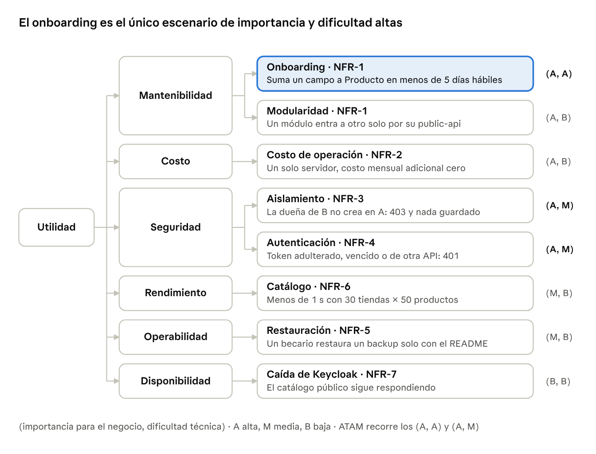

# Documento de Arquitectura – 4A Incubadora universitaria

18 de noviembre de 2026 · Núñez, Rzeszut, Tabaka

## 1. Dominio y escenario

El sistema es una plataforma multi-tienda para una incubadora universitaria: cada emprendedor gestiona su propia tienda online (catálogo, precios y ventas) y ninguno puede ver ni modificar datos de otra tienda. La plataforma además ofrece estadísticas agregadas de todas las tiendas al administrador.

Dominio 4 · Tiendas online para emprendedores. Escenario 4A · Incubadora universitaria.

La regla más importante del dominio es el **aislamiento entre tiendas** (multi-tenancy): es una invariante de negocio que condiciona el modelo de datos, la autorización y las consultas, aunque la escala sea chica.

Orden de magnitud para dimensionar: 30 tiendas × 50 productos = 1.500 productos como máximo. Es un volumen que cabe en una sola base de datos relacional sin particionado, caché distribuida ni colas externas.

| Dimensión | Definición del escenario |
| --- | --- |
| Escala | 30 tiendas, catálogos chicos (menos de 50 productos), tráfico bajo y parejo |
| Quién lo mantiene | 2 becarios que cambian todos los años |
| Infraestructura y presupuesto | Un servidor de la universidad |
| NFR estrella | Mantenibilidad y costo |
| Restricción que lo cambia todo | Un becario nuevo tiene que poder entender todo el sistema en una semana |

## 2. Actores, alcance y caso de uso mínimo

Hay tres roles y un único sistema externo: la pasarela de pagos, que se simula. Se implementa login más el caso de uso mínimo; el resto se diseña pero no se programa.

| Rol | Qué hace | Límite clave |
| --- | --- | --- |
| Administrador de la plataforma | Da de alta y baja tiendas y dueños; consulta estadísticas agregadas de todas las tiendas | No edita catálogos ni precios de una tienda |
| Dueño de tienda | Carga y edita productos y precios; ve las ventas de su tienda | Solo accede a los datos de su propia tienda |
| Comprador | Navega el catálogo de una tienda, arma el pedido y paga | Solo ve productos de la tienda que está visitando |

**Sistema externo: pasarela de pagos.** Se modela como un servicio externo con el que la plataforma se comunica por una interfaz propia (un puerto), con una implementación simulada (mock) que aprueba o rechaza pagos. Así el diseño ya contempla la integración real sin depender de un proveedor durante el desarrollo.

**Caso de uso mínimo:** un dueño de tienda carga un producto y un comprador lo ve en esa tienda, y no en otra. Es la prueba más corta de la regla de aislamiento.

**Corte a implementar:**

- [ ] Login con los tres roles — implementado: Keycloak autentica a `admin` (rol `admin`), a las dueñas `ana` y `carla` (rol `dueno`) y al comprador `beto` (rol `comprador`), desde el front `web` o desde Swagger UI. El administrador inicia sesión, pero sus funcionalidades (alta de tiendas y estadísticas) están diseñadas y sin implementar
- [ ] Carga de producto por el dueño — implementado: formulario en el front y `POST /tiendas/{id}/productos`; el gateway exige el rol `dueno` y la API verifica que el usuario sea el dueño de esa tienda
- [ ] Visualización del catálogo por el comprador — implementado: lista de tiendas y catálogo en el front, sobre `GET /tiendas` y `GET /tiendas/{id}/productos`, rutas públicas
- [ ] Verificación de que una tienda no ve los productos de otra — implementado y cubierto por tests de acceso cruzado (sección 13). En el front se ve en vivo: si `carla` intenta cargar un producto en la tienda de `ana`, la API responde 403

Quedan diseñados pero no implementados: el checkout con la pasarela y las estadísticas del administrador.

## 3. Requerimientos no funcionales

Mantenibilidad y costo mandan sobre todo lo demás: cuando un atributo compite con ellos, gana la simplicidad. Las métricas son propuestas de partida, ajustables con el equipo.

| ID | Atributo | Prioridad | Escenario y métrica objetivo | Cómo se verifica |
| --- | --- | --- | --- | --- |
| NFR-1 | Mantenibilidad (comprensibilidad) | Estrella | Un becario nuevo entiende el sistema completo en 1 semana: pocas unidades de despliegue, estructura de código predecible, README de arranque y C4 actualizados | Prueba de onboarding: un becario nuevo levanta el sistema local y agrega un campo a un producto en menos de 5 días hábiles |
| NFR-2 | Costo | Estrella | Opera en un solo servidor de la universidad, sin servicios pagos de nube, sin licencias y con pocas dependencias | Inventario de dependencias y servicios: costo mensual adicional igual a cero |
| NFR-3 | Seguridad y aislamiento entre tiendas | Alta | Un dueño nunca lee ni modifica datos de otra tienda; toda consulta se filtra por la tienda del usuario autenticado | Tests automatizados de acceso cruzado entre dos tiendas (el caso mínimo) en cada cambio |
| NFR-4 | Seguridad general | Alta | Credenciales gestionadas por Keycloak, access token firmado con vencimiento de 5 minutos, firma, emisor y audiencia validados en el gateway, HTTPS, validación de entrada, control de acceso por rol | Revisión contra OWASP Top 10, tests de autorización por rol (401 y 403) y prueba de token adulterado rechazado |
| NFR-5 | Operabilidad | Media | Un becario puede desplegar, hacer backup y restaurar con instrucciones escritas; logs legibles para diagnosticar fallas | Simulacro de restauración desde backup siguiendo solo la documentación |
| NFR-6 | Rendimiento | Media | Con tráfico bajo y parejo, las páginas de catálogo responden en menos de 1 segundo | Prueba de carga simple con datos de 30 tiendas y 50 productos cada una |
| NFR-7 | Disponibilidad | Baja | Una caída breve (horas) es tolerable; sin alta disponibilidad ni failover; backup diario | Política de backup documentada y probada |
| NFR-8 | Escalabilidad | Baja | No se diseña para crecer más allá de la escala del escenario; si creciera, se rediseña | Decisión explícita registrada en los ADRs |

**Compromisos asumidos:** se renuncia a escalabilidad horizontal y alta disponibilidad a cambio de simplicidad y costo cero adicional. Treinta tiendas con tráfico bajo no justifican microservicios, colas ni cachés distribuidas, y cada pieza extra encarece entender el sistema en una semana.

### Escenarios de calidad

Los dos NFR estrella y los dos de prioridad alta, escritos como escenarios de seis partes. Se leen como una oración: cuando \[fuente\] hace \[estímulo\] sobre \[artefacto\] en \[entorno\], el sistema \[respuesta\], medido como \[medida\].

| Parte | NFR-1 Mantenibilidad | NFR-2 Costo | NFR-3 Aislamiento | NFR-4 Seguridad |
| --- | --- | --- | --- | --- |
| Fuente | Un becario nuevo, sin conocimiento previo del sistema | La universidad | La dueña de la tienda B, autenticada | Un cliente con un token adulterado, vencido o emitido para otra API |
| Estímulo | Tiene que agregar un campo a Producto | Opera la plataforma durante un año | Intenta crear un producto en la tienda A | Llama a una ruta protegida |
| Artefacto | Módulo catálogo y la documentación (README, C4, ADRs) | El despliegue completo | Gateway y módulo catálogo | Gateway |
| Entorno | Desarrollo, al comienzo del año con el equipo renovado | Producción en el servidor de la universidad | Operación normal | Operación normal |
| Respuesta | Levanta el sistema, hace el cambio dentro del módulo y los tests pasan | Corre en un solo servidor, solo con software libre | Rechaza el alta sin guardar nada; el catálogo de B solo muestra productos de B | Rechaza el pedido antes de que llegue a la API |
| Medida | Menos de 5 días hábiles, tocando solo el módulo catálogo | Costo mensual adicional igual a cero; ninguna licencia paga | 0 accesos cruzados en la suite; 403 con Problem Details en el 100% de los intentos | 401 con `WWW-Authenticate` en el 100% de los casos de la suite |

### Utility tree



El onboarding es el único escenario (A, A): es la restricción que define el escenario 4A, y Keycloak lo vuelve más difícil. Aislamiento y autenticación son (A, M). Estos tres son los que recorre la evaluación de la sección 12; la dificultad es la estimación del equipo.

## 4. Restricciones, supuestos y riesgos

La restricción dominante es humana, no técnica: el equipo rota cada año, así que la arquitectura se juzga por lo rápido que alguien nuevo la entiende.

| Tipo | Detalle | Impacto en el diseño |
| --- | --- | --- |
| Restricción | Un solo servidor de la universidad | Una unidad de despliegue; base de datos y aplicación en la misma máquina |
| Restricción | 2 becarios que cambian cada año | Tecnologías comunes y documentadas; evitar patrones sofisticados |
| Restricción | Sin frameworks tipo Laravel | Estructura propia, simple y explícita, con librerías chicas y acotadas |
| Supuesto | Tráfico bajo y parejo, sin picos | No se dimensiona para picos ni se agrega caché distribuida |
| Supuesto | La pasarela de pagos real no se integra en esta etapa | Se simula detrás de una interfaz reemplazable |
| Riesgo | Se pierde conocimiento cuando egresan los becarios | Documentación viva (este documento, C4, ADRs) y prueba de onboarding anual |
| Riesgo | Fuga de datos entre tiendas por un error de filtrado | El filtro por tienda se aplica en un solo punto central, con tests de acceso cruzado |
| Riesgo | Servidor único como punto de falla | Backup diario y procedimiento de restauración probado |
| Riesgo | Keycloak y el gateway suman dos piezas que operar y entender | Realm versionado en el repo y reglas de rol en una sola tabla del gateway (ADR-11) |
| Riesgo | La tienda del alta de producto llega en la URL: un dueño podría apuntar a la tienda de otro | La API verifica que el usuario del token sea el dueño de esa tienda; lo cubren los tests de acceso cruzado (sección 13) |
| Riesgo | El front guarda el access token en sessionStorage, donde un XSS podría leerlo | Token de 5 minutos, React escapa el contenido y el front no usa HTML sin escapar (ADR-11) |

## 5. Estilo arquitectónico: matriz de Pugh

Gana el **monolito modular** (+1): iguala al monolito en capas en costo y operación, y lo supera en mantenibilidad porque separa el código por módulo de negocio. Microservicios y event-driven solo ganan en escalabilidad, un atributo de prioridad baja en este escenario (NFR-8).

Datum: monolito en capas. Escala: +1 mejor que el datum · 0 igual · −1 peor.

| Criterio (NFR) | Monolito en capas (datum) | Monolito modular | Microservicios | Event-driven |
| --- | --- | --- | --- | --- |
| Costo de infraestructura (NFR-2) | 0 | 0 | −1 | −1 |
| Complejidad operativa (NFR-5) | 0 | 0 | −1 | −1 |
| Escalabilidad (NFR-8) | 0 | 0 | +1 | +1 |
| Curva de aprendizaje (NFR-1) | 0 | 0 | −1 | −1 |
| Mantenibilidad (NFR-1) | 0 | +1 | −1 | −1 |
| **Total** | **0** | **+1** | **−3** | **−3** |

Propuesta para reforzar la matriz antes de la entrega: ponderar ×2 los criterios de los NFR estrella (costo y mantenibilidad). Así el resultado no depende de que todos los criterios pesen igual. Con esa ponderación el monolito modular queda en +2 y microservicios en −5.

## 6. C4 nivel 1: Contexto

La plataforma se relaciona con tres tipos de usuario y con un único sistema externo: la pasarela de pagos, simulada en esta etapa.


Los tres roles usan la misma plataforma por HTTPS; la línea punteada de la pasarela indica que es externa y, por ahora, simulada. Este nivel muestra solo quién usa el sistema y con qué se integra; la estructura interna se detalla en el C4 de contenedores.

## 7. C4 nivel 2: Contenedores

Son seis contenedores en un solo servidor, definidos en `infra/compose/docker-compose.yml`: `web`, el front propio en React servido por nginx; `gateway`, única entrada a la API, que valida el token, aplica las reglas por rol y le pasa a la API el usuario en `X-Usuario-Id`; `keycloak`, el proveedor de identidad OIDC; `backend`, el monolito modular en Node.js; `db`, PostgreSQL 16; y `swagger-ui`, cliente de prueba que publica el contrato OpenAPI. La pasarela de pagos es externa y la reemplazará un adaptador simulado dentro de `backend`.


El recuadro punteado es el servidor de la universidad. `backend` y `db` no publican puertos: solo se alcanzan por la red interna `backend`. `gateway` está en `backend` y en `identidad`, la red donde vive `keycloak`. `web` no reenvía llamadas: entrega los archivos estáticos y después el navegador habla directo con `keycloak` (login) y con `gateway` (API), que acepta por CORS solo los orígenes de `web` y `swagger-ui` (ADR-8).

Pregunta abierta resuelta: el borrador en draw.io separaba una app para cliente y vendedor y otra para el administrador. Quedó un solo front con vistas por rol, porque es una pieza menos que entender y desplegar (NFR-1); las vistas del administrador todavía no están implementadas.

## 8. Modelo de dominio

La **Tienda** es la raíz del aislamiento: todo lo que pertenece a una tienda lleva su id (`tienda_id` en la base). La tienda viaja en la URL (`/tiendas/{id}/…`) y la API verifica que el usuario del token, que el gateway le pasa en `X-Usuario-Id`, sea el dueño de esa tienda; el cliente no puede elegir con qué usuario actúa. Los módulos del monolito siguen los contextos del dominio, y la base implementada usa nombres en español.

| Entidad | Módulo | Atributos clave | Regla de negocio | Estado |
| --- | --- | --- | --- | --- |
| Store (Tienda) | Tiendas | id, nombre, dueno\_id | Solo el administrador la da de alta o de baja; `dueno_id` es el `sub` de Keycloak del dueño | Implementada (lectura) |
| User (Usuario) | Identidad | Vive en Keycloak: usuario, contraseña y rol | role ∈ {admin, dueno, comprador}; la API no tiene tabla de usuarios: el vínculo dueño → tienda es `tiendas.dueno_id` | En Keycloak |
| Product (Producto) | Catálogo | id, tienda\_id, nombre, precio, stock | Pertenece a una sola tienda; precio mayor a 0 y stock entero mayor o igual a 0. Sin tope por tienda: se asumen menos de 50 (dimensionamiento, NFR-6) | Implementada |
| Order (Pedido) | Pedidos | id, store\_id, buyer\_id, status, total | Todos sus ítems son de la misma tienda que el pedido | Diseñada |
| OrderItem (Ítem) | Pedidos | order\_id, product\_id, quantity, unit\_price | El precio se congela al confirmar el pedido | Diseñada |
| Payment (Pago) | Pagos | id, order\_id, status, gateway\_ref | Lo resuelve la pasarela a través del puerto `PaymentGateway` | Diseñada |

**Invariantes que garantizan el aislamiento:**

1. `store_id NOT NULL` en productos y pedidos (en la base implementada, tienda\_id); el dueño de cada tienda queda en tiendas.dueno\_id.
2. Claves foráneas compuestas `(store_id, id)`: un ítem de un pedido de la tienda A no puede referenciar un producto de la tienda B, lo impide la base.
3. Los repositorios reciben `store_id` como parámetro obligatorio; no existe un método "listar todos" fuera del módulo de estadísticas del administrador.

Pregunta abierta: ¿el comprador tiene una cuenta única para toda la plataforma o una por tienda? Una cuenta única es más simple para el usuario; el aislamiento no cambia porque los pedidos ya llevan `store_id`.

Con Keycloak la respuesta queda tomada en la práctica: hay un solo realm, `incubadora-universitaria`, y por lo tanto una cuenta por persona para toda la plataforma.

## 9. API (resumen del OpenAPI)

La API es REST y se consume solo a través del gateway, en `http://localhost:8000`, sin prefijo de versión y con rutas en español. El contrato vive en `docs/architecture/openapi/openapi.yaml` y Swagger UI lo publica en el puerto 8080. La tienda viaja en la URL y la API verifica el dueño con el usuario del token (sección 8).

| Método y ruta | Rol (regla del gateway) | Qué hace | Estado |
| --- | --- | --- | --- |
| Login y logout | Público | Los resuelve Keycloak con Authorization Code + PKCE (puerto 8180); la API no tiene endpoint propio | Implementado |
| GET /yo | Autenticado | Devuelve usuario, roles, emisor y vencimiento del token | Implementado (en el gateway) |
| GET /health | Público | Comprueba que la API y la base responden | Implementado |
| GET /tiendas | Público | Lista las tiendas | Implementado |
| GET /tiendas/{id} | Público | Devuelve una tienda | Implementado |
| GET /tiendas/{id}/productos | Público | Catálogo de una tienda | Implementado |
| POST /tiendas/{id}/productos | dueno | Crea un producto; la API verifica que el usuario sea el dueño de esa tienda | Implementado |
| POST /tiendas | admin | Da de alta una tienda | Regla en el gateway; falta contrato y API |
| DELETE /tiendas/{id} | admin | Da de baja una tienda | Regla en el gateway; falta contrato y API |
| POST /pedidos | comprador | Crea un pedido en una tienda | Diseñado |
| POST /pedidos/{id}/pagos | comprador | Pide el cobro a la pasarela simulada | Diseñado |
| GET /estadisticas | admin | Estadísticas agregadas de todas las tiendas | Diseñado |

**Convenciones:**

- Errores en formato `application/problem+json` (RFC 9457), con el mismo cuerpo en la API y en el gateway.
- Diseño: un recurso de otra tienda responde 404, no 403, para no revelar que existe. Hoy el código responde 403 cuando un dueño intenta crear en una tienda ajena; falta decidir cuál queda.
- 401 sin token válido, con el header `WWW-Authenticate: Bearer`; 403 cuando el rol no alcanza; 400 para errores de validación y para JSON mal formado (el diseño original proponía 422).
- Cada petición protegida lleva `Authorization: Bearer <access token>`. El gateway verifica la firma con las claves públicas de Keycloak (JWKS), el emisor, la audiencia `api-incubadora` y el vencimiento. Sin cookies no aplica CSRF. El gateway acepta por CORS una lista de orígenes (`CORS_ORIGIN`): hoy `web` (`:3000`) y Swagger UI (`:8080`). La API todavía responde CORS con `*`, aunque solo la llama el gateway.
- El front guarda el access token en `sessionStorage`: se borra al cerrar la pestaña, pero un XSS podría leerlo. Se acepta porque el token vence a los 5 minutos y React escapa el contenido que muestra (ADR-11).

## 10. Despliegue

Todo se levanta con un solo comando: `docker compose -f infra/compose/docker-compose.yml up -d --build`. Ese archivo define `db`, `backend`, `keycloak`, `gateway`, `web` y `swagger-ui`, más un servicio `backend-tests` que solo existe con el perfil `test` y corre los tests contra la base real. Todo vive en un único repositorio.

| Servicio | Qué corre | Expone | Datos persistentes |
| --- | --- | --- | --- |
| web | nginx (alpine) con el build estático del front en React 19 + Vite; la imagen se compila en una etapa con node:22-alpine | 3000 hacia los usuarios | No |
| gateway | Node.js 22 + Express 5 + jose: valida el token, aplica las reglas por rol y reenvía a la API con el usuario en `X-Usuario-Id` | 8000 hacia los usuarios | No |
| keycloak | Keycloak 26.2.5 en modo desarrollo; importa el realm `incubadora-universitaria` desde `infra/keycloak` | 8180 (login en el navegador) | Base interna de Keycloak, sin volumen |
| backend | Monolito modular en Node.js 22 + Express 5 + pg | Solo red backend | No |
| db | PostgreSQL 16 (alpine); la primera vez corre las migraciones de cada módulo y los datos de ejemplo de `infra/database/init` | Solo red backend | Volumen pgdata |
| swagger-ui | Swagger UI 5.17.14 con login OAuth (PKCE) contra Keycloak; cliente de prueba que publica el `openapi.yaml` | 8080 | No |
| backend-tests | Solo con el perfil `test`: la imagen del backend más `tests/`, contra `db` | Solo red backend | No |

La pasarela de pagos simulada correrá dentro de `backend` como una implementación del puerto `PaymentGateway` (diseñada, todavía sin código); no es un contenedor aparte. Cambiarla por un proveedor real es escribir otra implementación y cambiar una variable de entorno.

**Operación (NFR-5 y NFR-7):**

- Backup diario con `pg_dump` programado en el servidor; se guardan los últimos 7. Pendiente de implementar.
- Restauración documentada paso a paso en el README y probada con un simulacro. Pendiente.
- Configuración por variables de entorno. Hoy las contraseñas de `db` y de la consola de Keycloak están escritas en docker-compose.yml; hay que moverlas a `.env` (ya ignorado por git) y versionar un `.env.example`.
- Las imágenes del backend y del gateway corren con el usuario `node`, no como root, y usan `.dockerignore`.
- Logs a la salida estándar, consultables con `docker compose logs`.

## 11. Decisiones de arquitectura (ADRs)

Hay 11 ADRs: 10 aceptados (dos de ellos, ADR-4 y ADR-5, todavía sin código) y 1 reemplazado (ADR-3, por ADR-11). Cada uno sigue el formato de la cátedra y tiene su archivo en `docs/architecture/adr/` (ADR-6), con un `README.md` de índice. ADR-7, ADR-8, ADR-10 y ADR-11 se revisaron el 18/11, cuando se sumó el front.

| ADR | Decisión | Estado |
| --- | --- | --- |
| ADR-1 | Monolito modular | Aceptada |
| ADR-2 | Una base relacional con aislamiento por `store_id` | Aceptada |
| ADR-3 | Autenticación propia con sesión en el servidor | Reemplazada por ADR-11 |
| ADR-4 | Pasarela de pagos detrás de un puerto, con implementación simulada | Aceptada |
| ADR-5 | Estadísticas con consultas sobre la misma base | Aceptada |
| ADR-6 | Documentación viva en el repositorio | Aceptada |
| ADR-7 | Stack: Node.js 22, Express 5, pg, PostgreSQL 16 y React 19 | Aceptada |
| ADR-8 | Front propio como SPA estática; el gateway es la única entrada a la API | Aceptada |
| ADR-9 | Monorepo con front y back | Aceptada |
| ADR-10 | Despliegue con Docker Compose en un solo servidor | Aceptada |
| ADR-11 | Identidad con Keycloak y gateway como única entrada | Aceptada |

### ADR-1: Monolito modular

- **Estado:** Aceptada
- **Contexto:** 30 tiendas con tráfico bajo, un solo servidor y 2 becarios que rotan cada año. El sistema tiene que entenderse en una semana.
- **Decisión:** Vamos a construir una sola aplicación desplegable, dividida en módulos internos por contexto de negocio: identidad, tiendas, catálogo, pedidos, pagos y estadísticas.
- **Alternativas:** Monolito en capas (más simple, pero mezcla negocios distintos en las mismas capas); microservicios y event-driven (−3 en la matriz de Pugh: más infraestructura, más operación y más curva de aprendizaje).
- **Consecuencias:** Una unidad que entender, desplegar y pagar; cada módulo se lee de forma aislada. Se resigna escalar módulos por separado. Hay que cuidar que un módulo no lea las tablas de otro.
- **NFRs:** Favorece NFR-1, NFR-2 y NFR-5. Perjudica NFR-8, que tiene prioridad baja.
- **Confirmación:** el test de arquitectura (`apps/backend/tests/architecture/dependencias.test.js`) falla si un módulo importa capas internas de otro sin pasar por su `public-api`, o si se rompen las dependencias entre capas. Corre con `npm test`.

### ADR-2: Una base relacional con aislamiento por store\_id

- **Estado:** Aceptada
- **Contexto:** La regla central es el aislamiento total entre tiendas. Con 1.500 productos como máximo, el volumen cabe en una sola base.
- **Decisión:** Vamos a usar una única base relacional con tablas compartidas: cada tabla de tienda lleva `store_id NOT NULL`; la tienda viaja en la URL, la API verifica que el usuario del token (ADR-11) sea su dueño y el filtro se aplica en la capa de repositorios.
- **Alternativas:** Una base por tienda o un esquema por tienda: se descartan porque implican 30 migraciones, 30 backups y 30 conjuntos de conexiones sin beneficio a esta escala.
- **Consecuencias:** Una migración y un backup. El riesgo es olvidar un filtro; se mitiga con FK compuestas `(store_id, id)`, repositorios que exigen `store_id` y tests de acceso cruzado. Con PostgreSQL se puede sumar Row-Level Security como segunda barrera.
- **NFRs:** Favorece NFR-1, NFR-2 y NFR-3 (con sus tests). El aislamiento depende de la disciplina del código, no de la infraestructura.
- **Confirmación:** los tests de acceso cruzado (`apps/backend/tests/integration/`): la dueña de la tienda B no puede crear productos en la A y el catálogo de B no muestra productos de A. La misma prueba corre contra PostgreSQL real con el perfil `test` del compose.

### ADR-3: Autenticación propia con sesión en el servidor (reemplazada)

- **Estado:** Reemplazada por ADR-11. Se conserva como registro de la decisión original.
- **Contexto:** Tres roles, sin presupuesto, en un servidor propio. La cátedra presentó proveedores de identidad con OIDC como opción.
- **Decisión:** Vamos a autenticar con usuario y contraseña propios (hash adaptativo bcrypt o argon2) y mantener la sesión en el servidor, con una cookie `HttpOnly`, `Secure` y `SameSite`, y expiración por inactividad.
- **Alternativas:** Proveedor de identidad externo con OIDC: más seguro de base, pero suma una pieza más para operar y entender. JWT sin estado: complica la revocación de sesiones y no aporta nada con un solo servidor.
- **Consecuencias:** Sin costo ni dependencia externa, y el flujo completo se lee en un solo módulo. Se resigna SSO y MFA; el hashing, la expiración y la protección CSRF quedan a cargo propio. Si la universidad ofreciera un IdP institucional, se revisa este ADR.
- **NFRs:** Favorece NFR-1 y NFR-2. Exige cuidado extra para cumplir NFR-4.

### ADR-4: Pasarela de pagos detrás de un puerto, con implementación simulada

- **Estado:** Aceptada
- **Contexto:** La pasarela real no se integra en esta etapa, pero el checkout debe quedar diseñado.
- **Decisión:** Vamos a definir una interfaz `PaymentGateway` (puerto) en el módulo de pagos, con una implementación simulada que aprueba o rechaza según el monto o una regla fija.
- **Alternativas:** Integración directa con un proveedor: ata el desarrollo y los tests a un tercero.
- **Consecuencias:** Se prueba sin red ni credenciales; cambiar de proveedor es escribir otro adaptador. Se resigna probar contra el comportamiento real del proveedor (demoras, webhooks).
- **NFRs:** Favorece NFR-1 y NFR-2.
- **Confirmación:** prevista para cuando se implemente el módulo de pagos: un test del cobro corre contra el mock, sin red ni credenciales, y cubre un pago aprobado y uno rechazado.

### ADR-5: Estadísticas con consultas sobre la misma base

- **Estado:** Aceptada
- **Contexto:** El administrador necesita estadísticas agregadas de todas las tiendas, sobre un volumen muy chico.
- **Decisión:** Vamos a calcular las estadísticas con consultas SQL de agregación sobre la base principal, en un módulo de solo lectura accesible únicamente para el rol administrador.
- **Alternativas:** Almacén de datos o proceso de analítica aparte: es otra pieza que operar, injustificada para 1.500 productos.
- **Consecuencias:** Cero infraestructura extra. Es el único módulo que consulta sin filtrar por tienda, por eso tiene sus propios tests de autorización.
- **NFRs:** Favorece NFR-2. Exige cuidado en NFR-3.
- **Confirmación:** prevista para cuando se implemente: un test de autorización en el que solo el rol `admin` accede a `GET /estadisticas`, y `dueno` y `comprador` reciben 403.

### ADR-6: Documentación viva en el repositorio

- **Estado:** Aceptada
- **Contexto:** El conocimiento se pierde cada vez que egresan los becarios.
- **Decisión:** Vamos a guardar el C4, los ADRs y el OpenAPI en `docs/`architecture/, dentro del mismo repositorio que el código, y a actualizarlos en el mismo commit que cambia la arquitectura.
- **Alternativas:** Documentación en una wiki o en documentos aparte: se desactualiza porque no cambia junto con el código.
- **Consecuencias:** Un solo lugar donde buscar. Requiere la disciplina de actualizar `docs/` en cada cambio relevante.
- **NFRs:** Favorece NFR-1 y NFR-5.
- **Confirmación:** antes de cada tag se revisa que los servicios del C4 de contenedores coincidan con `infra/compose/docker-compose.yml`. Swagger UI publica directamente el `openapi.yaml` del repositorio, así que lo que se prueba es el contrato versionado.

### ADR-7: Stack tecnológico

- **Estado:** Aceptada (revisada el 18/11: se suma el front)
- **Contexto:** Sin Laravel ni frameworks similares. Tiene que ser un lenguaje que un becario promedio ya conozca o aprenda rápido, con librerías chicas. El repositorio arrancó sobre la base de la Clase 10. El front necesita login OIDC, listas y un formulario.
- **Decisión:** Back-end en Node.js 22 con Express 5 como router mínimo y el driver `pg` con SQL parametrizado escrito a mano. Base PostgreSQL 16, que permite Row-Level Security como refuerzo del ADR-2. El gateway usa el mismo stack más `jose` para validar JWT. Front en React 19 con Vite 8 y react-router 7, compilado a archivos estáticos que sirve nginx; el login con PKCE se escribe a mano con la Web Crypto API, sin librería OIDC. Imágenes `node:22-alpine`, `postgres:16-alpine` y `nginx:alpine`.
- **Alternativas:** Python con un micro-framework o Go con la librería estándar: igual de livianos, pero el material de la cátedra y el código inicial ya están en JavaScript. Un ORM: no se usa, así el filtro por tienda queda a la vista en cada consulta. Front en JavaScript sin librería: menos dependencias, pero el estado de cada vista queda a mano en cada página. Next.js u otro framework sobre React: suma un servidor y convenciones propias, justo lo que la restricción quiere evitar.
- **Consecuencias:** Un solo lenguaje en front, gateway y API. Backend y gateway con dos dependencias directas cada uno, el front con tres de ejecución, todas MIT; nginx es BSD-2-Clause. React es una librería de interfaz, no un framework de aplicación como Laravel: no decide la estructura del backend ni el acceso a datos. Se resigna el tipado estático; la validación queda a mano y las reglas del producto están duplicadas en el formulario y en el dominio. React, Vite y el paso de build suman a lo que un becario tiene que aprender.
- **NFRs:** Favorece NFR-2. En NFR-1 es mixto: un solo lenguaje lo favorece; React y el build lo perjudican.
- **Confirmación:** los `package.json` del backend (express, pg), del gateway (express, jose) y del front (react, react-dom, react-router-dom); los Dockerfiles fijan `node:22-alpine` y, en el front, `nginx:alpine`.

### ADR-8: Front propio como SPA estática; el gateway es la única entrada a la API

- **Estado:** Aceptada (revisada el 18/11). La primera versión ponía a `web` como única puerta de entrada y proxy de la API; al implementarlo, el gateway (ADR-11) ya cumplía ese rol y `web` quedó como servidor de archivos estáticos.
- **Contexto:** Hay que servir la interfaz de los tres roles y exponer la API de forma segura. El gateway ya es la única entrada a la API, y `backend` y `db` no publican puertos.
- **Decisión:** Vamos a tener un contenedor `web` propio (nginx) que solo sirve el build estático de React, con vistas por rol en un solo front. El navegador habla directo con Keycloak para el login (PKCE, cliente público `web-incubadora`) y con el gateway para la API, que acepta por CORS solo los orígenes de `CORS_ORIGIN`.
- **Alternativas:** Que el nginx de `web` haga de proxy inverso hacia el gateway y Keycloak: un solo origen y sin CORS, pero una configuración de nginx más que entender. Servir la interfaz desde la API o desde el gateway: un contenedor menos, pero mezcla la interfaz con el negocio o con la seguridad. Dos fronts separados (cliente-vendedor y administrador), como el borrador en draw.io: el doble de piezas.
- **Consecuencias:** `web` no tiene lógica ni secretos; cada contenedor hace una sola cosa. Se resigna tener un solo puerto: hacia el usuario quedan 3000 (`web`), 8000 (`gateway`) y 8180 (`keycloak`), más 8080 de Swagger UI. Hay que mantener alineados `CORS_ORIGIN` y el redirect URI del realm. Las URLs de Keycloak y del gateway están escritas en el código del front, y nginx necesita un fallback a `index.html` para que una recarga en `/tiendas/1` no dé 404.
- **NFRs:** Favorece NFR-1 (cada contenedor hace una sola cosa) y NFR-4 (la API sigue sin puerto publicado). Perjudica un poco NFR-5, por los orígenes y las URLs que hay que configurar.
- **Confirmación:** `docker compose ps` muestra que `backend` y `db` no publican puertos y que `web` solo publica el 3000. El gateway rechaza con 404 cualquier ruta que no esté en su tabla de reglas.

### ADR-9: Monorepo con front y back

- **Estado:** Aceptada
- **Contexto:** Primero se separaron front y back en dos repositorios.
- **Decisión:** Vamos a usar un único repositorio con el front, el back y `docs/` juntos, con nombres de carpetas en inglés (apps/, infra/, docs/) y los módulos de negocio en español (identidad, tiendas, catalogo, pedidos, pagos).
- **Alternativas:** Dos repositorios, uno para el front y otro para el back: es la opción que se probó primero y se descartó.
- **Consecuencias:** Un solo clon, un solo `docker compose up`, un solo tag `v1.0` para la entrega; los cambios que tocan front y back van en el mismo commit. Se resigna versionar y desplegar front y back por separado, algo que no hace falta a esta escala.
- **NFRs:** Favorece NFR-1 y NFR-5.
- **Confirmación:** un solo clon del repositorio alcanza para levantar todo y correr todos los tests; el tag `v1.0` cubre código, infraestructura y documentación.

### ADR-10: Despliegue con Docker Compose en un solo servidor

- **Estado:** Aceptada (revisada el 18/11: se suma `web`)
- **Contexto:** Un solo servidor de la universidad, sin servicios de nube y con becarios que tienen que desplegar sin ayuda.
- **Decisión:** Vamos a definir los servicios en Compose y levantarlos con un solo comando, igual en local que en el servidor. Es un solo archivo, `infra/compose/docker-compose.yml`, con `db`, `backend`, `keycloak`, `gateway`, `web` y `swagger-ui`; el servicio `backend-tests` solo existe con el perfil `test`.
- **Alternativas:** Instalación manual en el servidor (difícil de reproducir); Kubernetes o servicios de nube (costo y complejidad injustificados).
- **Consecuencias:** El entorno local es idéntico al de producción y el onboarding empieza con un comando. Se resignan alta disponibilidad y escalado automático; el servidor es un único punto de falla. Hoy algunas contraseñas de desarrollo están escritas en el compose y hay que pasarlas a `.env`.
- **NFRs:** Favorece NFR-1, NFR-2 y NFR-5. Perjudica NFR-7, que tiene prioridad baja.
- **Confirmación:** `docker compose -f infra/compose/docker-compose.yml up -d --build` levanta los seis servicios en una máquina limpia; es el primer paso de la prueba de onboarding (NFR-1).

### ADR-11: Identidad con Keycloak y gateway como única entrada

- **Estado:** Aceptada. Reemplaza a ADR-3 (revisada el 18/11: se suma el cliente del front).
- **Contexto:** La Clase 11 presentó OIDC con Keycloak y un gateway delante de la API. El equipo lo adoptó en el repositorio en lugar de la autenticación propia de ADR-3.
- **Decisión:** Keycloak es el proveedor de identidad, con el realm `incubadora-universitaria` versionado en `infra/keycloak/`, los roles `admin`, `dueno` y `comprador` y dos clientes públicos con PKCE: `web-incubadora` (el front) y `swagger-ui`. Un gateway propio (`infra/gateway/`) es la única puerta a la API: verifica firma, emisor, audiencia y vencimiento del access token, aplica una tabla de reglas método + ruta → roles y le pasa a la API el usuario (`sub`) en el header `X-Usuario-Id`, que arma desde cero para que el cliente no pueda inventarlo. La API no publica puertos. El front guarda el token en `sessionStorage` y lo manda como `Authorization: Bearer`.
- **Alternativas:** Autenticación propia con sesión en el servidor (ADR-3): una pieza menos, pero el hashing, la expiración, CSRF y la revocación quedan a cargo de becarios que rotan. Validar el token dentro de la API: ahorra un contenedor, pero mezcla seguridad con negocio. Guardar el token solo en memoria en el front: más resistente a XSS, pero se pierde con cada recarga.
- **Consecuencias:** Login, contraseñas y vencimientos quedan en un producto libre (Apache 2.0) y mantenido por terceros; un token adulterado falla la verificación de firma. Se suman dos contenedores y un concepto nuevo (OIDC) al onboarding. El token vale hasta su vencimiento de 5 minutos, sin revocación inmediata, y el front no lo renueva: al vencer, hay que volver a iniciar sesión. En `sessionStorage` un XSS podría leerlo; se acepta por el vencimiento corto y porque React escapa el contenido. Keycloak corre en modo desarrollo, sin HTTPS ni base persistente; en el servidor hace falta `start` con HTTPS y su propia base. La API confía en `X-Usuario-Id` porque solo la alcanza el gateway, por la red interna.
- **NFRs:** Favorece NFR-4 y mantiene NFR-2 en costo cero. Perjudica NFR-1 y NFR-5 por las piezas extra; NFR-3 se cubre con la verificación de dueño en la API y sus tests.
- **Confirmación:** los tests del gateway (`infra/gateway/tests/autorizacion.test.js`) firman tokens con una clave propia y verifican que se rechace con 401 un token con firma ajena, emisor o audiencia equivocados o vencido; que se rechace con 403 un rol insuficiente; y que un `X-Usuario-Id` inventado por el cliente se descarte.

## 12. Evaluación de la arquitectura

La debilidad principal es que el aislamiento descansa en dos cosas que no garantiza la infraestructura: que cada caso de uso verifique al dueño y que la API nunca publique su puerto. Sale de una evaluación liviana al estilo ATAM (Clase 13): los escenarios (A, A) y (A, M) del utility tree, recorridos sobre el C4 de contenedores.

| Hallazgo | Onboarding · NFR-1 (A, A) | Aislamiento · NFR-3 (A, M) | Autenticación · NFR-4 (A, M) |
| --- | --- | --- | --- |
| Enfoque | Monolito modular con las mismas capas en cada módulo, un solo compose y Keycloak + gateway (ADR-1, ADR-10, ADR-11) | La tienda viaja en la URL, la API verifica al dueño y los repositorios filtran por `tienda_id` (ADR-2) | El gateway valida firma, emisor, audiencia y vencimiento con las claves públicas de Keycloak (ADR-11) |
| Punto de sensibilidad | El tiempo de onboarding depende de cuántas piezas hay que entender: seis contenedores, un front en React y un concepto nuevo, OIDC | Depende de que cada caso de uso que escribe verifique al dueño y de que cada consulta filtre por `tienda_id` | Depende de que toda ruta protegida esté en la tabla de reglas y de que la API solo sea alcanzable a través del gateway |
| Punto de trade-off | Keycloak mejora la seguridad (NFR-4) a costa de comprensibilidad (NFR-1) y operación (NFR-5) | Una base compartida baja el costo (NFR-2), pero deja el aislamiento en manos del código (NFR-3) | El token sin estado evita consultar a Keycloak en cada pedido, pero no se puede revocar antes de sus 5 minutos |
| Riesgo | Un becario sin experiencia en OIDC puede tardar en entender el realm y los tokens; Keycloak corre en modo desarrollo, sin base persistente | Un endpoint nuevo que olvide la verificación expone datos de otra tienda; Row-Level Security no está implementado | La API confía en `X-Usuario-Id`: si alguien publica el puerto del backend, cualquiera puede hacerse pasar por otro usuario |
| No-riesgo | El código de negocio se lee módulo por módulo, y el test de arquitectura impide que la estructura se erosione | El cliente no elige el usuario: `X-Usuario-Id` lo arma el gateway desde el token validado | Una ruta que no está en la tabla de reglas responde 404 y no llega a la API: el gateway falla cerrado |
| Qué se hace con el riesgo | Verificación: prueba de onboarding con alguien ajeno (NFR-1). Aceptado: Keycloak en modo desarrollo, documentado en ADR-11 | Verificación: tests de acceso cruzado en cada cambio. Aceptado por ahora: RLS queda como segunda barrera futura (ADR-2) | Verificación: la confirmación del ADR-8 (`docker compose ps` sin puertos de `backend` ni `db`) |

**Tema de riesgo:** la seguridad del aislamiento depende de la disciplina del código y de la topología de red, no de la base. Amenaza el objetivo central del dominio, el aislamiento total entre tiendas. Por eso la verificación de dueño tiene tests automáticos, y la topología se revisa antes de cada tag con docker compose ps.

## 13. Verificación de NFRs

Tres NFRs se verifican con pruebas automatizadas: NFR-1, NFR-3 y NFR-4. Para el resto, la columna de resultado da el argumento: qué decisión o táctica lo sostiene y por qué alcanza a esta escala.

| NFR | Evidencia en la entrega | Dónde se ve | Resultado |
| --- | --- | --- | --- |
| NFR-1 Mantenibilidad | Test de arquitectura que falla si un módulo entra a otro sin pasar por su `public-api` o si se rompen las capas; prueba de onboarding: alguien ajeno clona el repositorio, lo levanta y agrega un campo a Producto siguiendo solo el README | `apps/backend/tests/architecture/`, README, tiempo medido | Parcial: el test de arquitectura está en verde; falta la prueba de onboarding |
| NFR-2 Costo | Inventario de dependencias, todas con licencia libre; un solo servidor, sin servicios pagos | Tabla de dependencias en el README | Por inventario: Keycloak y Swagger UI (Apache 2.0), PostgreSQL (licencia PostgreSQL), Express, pg, jose, React, react-router y Vite (MIT), nginx (BSD-2-Clause). Todo corre en el servidor de la universidad: costo mensual adicional cero. La tabla está en el README |
| NFR-3 Aislamiento | Tests automatizados de acceso cruzado: la dueña de la tienda A carga un producto, el catálogo de la tienda B no lo muestra y la dueña de B recibe 403 al intentar crear en A; la misma prueba corre contra PostgreSQL real | `apps/backend/tests/integration/`, perfil `test` del compose | Cumplido en la suite del backend (45 tests en verde); falta registrar la corrida contra la base del compose |
| NFR-4 Seguridad general | Tests del gateway: 401 sin token, con firma ajena, con emisor o audiencia equivocados y con token vencido; 403 cuando el rol no alcanza; un `X-Usuario-Id` inventado por el cliente se descarta. Revisión contra OWASP Top 10 | `infra/gateway/tests/` | Parcial: 13 tests en verde; falta la revisión OWASP |
| NFR-5 Operabilidad | Simulacro: backup con pg\_dump y restauración siguiendo solo el README | Argumento, sin prueba ejecutada | Lo sostienen una sola base (ADR-2), un solo comando para levantar todo (ADR-10) y los logs en la salida estándar (`docker compose logs`). El backup es un `pg_dump` de esa única base |
| NFR-6 Rendimiento | Datos de prueba con 30 tiendas × 50 productos y medición del tiempo de respuesta del catálogo, objetivo menor a 1 s | Argumento, sin prueba ejecutada | Lo sostiene el volumen: 1.500 productos como máximo, y el catálogo es una sola consulta filtrada por `tienda_id` en la misma máquina, sin servicios externos en el camino. Con tráfico bajo y parejo no hay contención |
| NFR-7 Disponibilidad | Política de backup diario documentada y probada | Argumento, sin prueba ejecutada | Prioridad baja por decisión (ADR-10): una caída de horas es tolerable. Además, el catálogo público no depende de Keycloak, porque el gateway no valida token en esas rutas; si se cae el proveedor de identidad, solo se frenan las altas |
| NFR-8 Escalabilidad | Decisión explícita de no escalar horizontalmente | ADR-1 y ADR-10 | Cumplido por decisión |

## 14. Estado del repositorio y pendientes

Al 18 de noviembre de 2026, en la rama `pruebareact`, el caso de uso mínimo funciona de punta a punta desde el front: login con Keycloak, lista de tiendas, catálogo y carga de producto, con el aislamiento verificado por tests. Desde el 12/11 se resolvieron el usuario administrador, el `security: []` del OpenAPI, el cliente sobrante del realm, el front, los ADRs en el repositorio y el README. Lo que falta, ordenado por lo que bloquea la entrega:

| # | Pendiente | Dónde | Qué hacer |
| --- | --- | --- | --- |
| 1 | El trabajo vive en `pruebareact`; `main` está atrasado y no hay tag | Git | Merge a `main`, `docker compose down -v` y `up` desde cero, tests en verde, tag `v1.0` |
| 2 | Tienda ajena: el diseño dice 404 y el código responde 403 | `crear-producto.js`, sección 9, ADR-2 | Decidir uno y alinear código, tests, OpenAPI y documento |
| 3 | Contraseñas escritas en el compose; falta `.env.example` | `infra/compose/docker-compose.yml` | Pasarlas a `.env` y versionar el ejemplo |
| 4 | Recargar `/tiendas/1` en el front da 404 de nginx | `apps/frontend` | `nginx.conf` con `try_files $uri /index.html` |
| 5 | El build del front copia `node_modules` del host | `apps/frontend` | Agregar `.dockerignore` |
| 6 | URLs de Keycloak y del gateway repetidas en cuatro archivos del front | `apps/frontend/src` | Un solo `config.js` con `import.meta.env.VITE_*` |
| 7 | Resto de la práctica: la regla `GET /productos` en el gateway | `infra/gateway/src/app.js` | Borrarla |
| 8 | La API responde CORS con `*` aunque solo la llama el gateway | `apps/backend/src/main/http.js` | Quitarlo |
| 9 | Falta la prueba de onboarding (NFR-1) y la revisión OWASP (NFR-4) | README, sección 13 | Hacerlas y registrar el resultado |
| 10 | El administrador entra pero no tiene funcionalidades | módulos `tiendas` y estadísticas | Diseñado (ADR-5); opcional para la entrega |
| 11 | La pasarela de pagos simulada no tiene código | módulo `pagos` | Opcional: el puerto `PaymentGateway` y su mock (ADR-4) |

## Anexo: cómo levantarlo y usuarios de prueba

El mismo contenido va en el README del repositorio; la consigna pide ahí cómo levantar el sistema y los usuarios de prueba.

1. Clonar el repositorio y entrar a la carpeta.
2. Ejecutar `docker compose -f infra/compose/docker-compose.yml up -d --build`.
3. Esperar a que `keycloak` figure como `healthy` en `docker compose -f infra/compose/docker-compose.yml ps`.
4. Abrir el front en `http://localhost:3000`, tocar «Iniciar sesión» y entrar con un usuario de prueba. Para probar la API sin el front, Swagger UI está en `http://localhost:8080` (botón Authorize).
5. Para los tests: `npm ci` y `npm test` en `apps/backend` y en `infra/gateway`; contra la base real, `docker compose -f infra/compose/docker-compose.yml --profile test run --rm --build backend-tests`.

Los usuarios de prueba los importa Keycloak desde `infra/keycloak/realm-incubadora.json`; las contraseñas están en ese archivo, no en este documento. Las tiendas y sus productos de ejemplo los carga `infra/database/init/datos-ejemplo.sql`.

| Usuario | Rol | Tienda | Para probar |
| --- | --- | --- | --- |
| `admin` | admin | Ninguna | Login de administrador (sus funcionalidades están diseñadas, sin implementar) |
| `ana` | dueno | Tienda de mates Unahur (id 1) | Carga de producto en su tienda |
| `carla` | dueno | Repostería (id 2) | Que no puede cargar productos en la tienda de ana (403) |
| `beto` | comprador | Ninguna | Catálogo de cualquier tienda; no ve el formulario de carga |

Estructura actual del monorepo:

```
/
├── apps/
│   ├── backend/
│   │   ├── src/
│   │   │   ├── main/                # composition root
│   │   │   ├── modules/             # identidad, tiendas, catalogo, pedidos, pagos
│   │   │   │   └── <modulo>/        # domain, application, infrastructure, presentation, public-api
│   │   │   └── shared/              # kernel (errores) e infraestructura (config, base)
│   │   └── tests/                   # unit, integration, architecture
│   └── frontend/                    # React + Vite, servido por nginx
│       └── src/                     # app/, features/{autenticacion,vitrina}, shared/
├── docs/architecture/               # adr/, c4/, openapi/openapi.yaml
├── infra/
│   ├── compose/docker-compose.yml   # todos los servicios
│   ├── database/init/               # corre las migraciones y los datos de ejemplo
│   ├── gateway/                     # src/ y tests/
│   └── keycloak/                    # realm versionado
├── .gitignore
└── README.md
```

De los cinco módulos del backend, solo `tiendas` y `catalogo` tienen código; los otros tres tienen la estructura de capas lista y un README con su responsabilidad. En el front existen las features `autenticacion` y `vitrina`.
